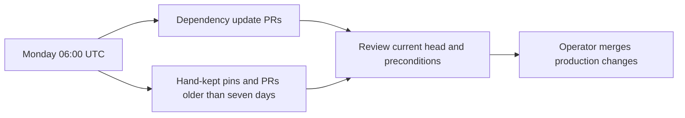

# Weekly dependency updates

Both schedules request Monday **06:00 UTC**; GitHub can delay scheduled runs.
This repository follows the shared dependency-update template and the org-wide
plan tracked here by [#144](https://github.com/agenticcodingops/azure-wordpress/issues/144).
The freshness caller also supports manual dispatch. Its workflow and script
checkout pin public auto-code-scanning `25f0b8722593e588ef573858bc46e1df9d7a1804`
(v3.1.0). This change schedules reporting; it changes no application pin.

## Inventory and coverage

Inventory measured on 2026-11-09. Dependabot does not recurse. The configuration
has 15 entries: GitHub Actions at `/`, and Terraform at every directory below.

| Terraform directory | Readable manifests |
|---|---|
| `/` | Existing root entry retained; `versions.tf` is empty today |
| `/modules/wordpress-site`, `/modules/shared-infrastructure` | Inline provider constraints in `main.tf` |
| `/modules/app-service`, `/modules/cloudflare`, `/modules/database`, `/modules/dns-zones`, `/modules/front-door`, `/modules/key-vault`, `/modules/monitoring`, `/modules/networking`, `/modules/storage` | Each directory's `versions.tf` |
| `/examples/basic-site`, `/examples/multi-site` | Providers and versioned module sources in `main.tf` |

There are no tracked npm, Composer, Python package, container-build, or pre-commit
manifests. Python scripts alone are not pip manifests. Provider lock files are
ignored; local module sources are not independent registry dependencies.

| Surface | Selection and coverage |
|---|---|
| Active Actions | Dependabot reads workflows: checkout v7/v7.0.1, setup-terraform v4.0.1, Checkov action v12.3136.0, terraform-docs action v1.4.1, setup-python v5.6.0, release action v5.0.0, and reusable scan/fix callers v3.0.6. Majors arrive separately. |
| Review action | v1.0.266 in both review workflows; unconditionally ignored by Dependabot. Freshness checks SHA/tag comments. The older action selection in `scan-config.yaml` has its own freshness entry because it serves a separate fix-loop role. |
| Platform copies | Freshness compares scan/fix `uses`, both ref-input spellings, comments, runner/config header, and current guidance. Vendored `hooks/`, shared scripts and schemas move together when upgrading the platform. It does not verify their bytes. |
| Terraform CLI | 1.9.8 in `.terraform-version`, validation env and active guidance; freshness compares upstream releases and mirrors. Compatibility floors in HCL/README are a separate `minimum` entry. All CLI/provider changes are operator-owned. |
| Scanner/tool guidance | Freshness checks terraform-docs 0.20.0, Checkov guidance 3.3.22 and the validation action mirror, Semgrep container guidance 1.178.0, and local tflint rulesets 0.15.0/0.32.0. Existing guidance/action drift remains visible. The Checkov engine bundled by its action must be read from upstream `action.yml`, not inferred from the action version. |
| Script-installed dependencies | PyYAML 6.0.3 and jsonschema 4.25.1 in workflows and installation guidance are freshness entries. The manifest also records Python 3.11, Lefthook 1.6.0, and scanner minimums as compatibility selections. No exact local Gitleaks, Trivy or tflint installation version is pinned here; their platform-provided versions belong to the platform release. |
| Containers/runtimes | The Semgrep digest is a manual reminder, separate from its version comment. WordPress image series 8.3 and MySQL 8.0.21 defaults are manual reminders with mirror checks. Neither tool validates MCR image builds, authenticates digests, or checks Azure's supported service catalog. Follow the image and database runbooks. |
| Review service and runners | The review model/API identifiers, REST API date, and `ubuntu-latest` labels are manual reminders. Release APIs do not validate model availability or hosted image contents. |
| Neither: deliberate gaps | Historical changelog/upgrade evidence, example release tags and this module's own release numbers are release-managed or historical. Vendored provenance headers (verified byte-for-byte during platform upgrades), generated README provider mirrors, Bash/Python prose floors outside the explicit runtime entry, scanner rule registries, local PATH installations and transitive action-installed CLIs/SDKs require deliberate review. No freshness claim is made for these. The rolling report cannot prove a version/digest pair or installed scanner contents. |

The manifest has 26 entries. `minimum` reports compatibility selections without
calling them outdated installations. `manual` keeps a selection visible and
compares mirrors; it performs no upstream validation. This inventory is a dated
snapshot, not another executable version mirror.

## Preconditions and ownership

Keep the existing provider-major ignore and its explanation in every Terraform
entry: "The composition module and its sub-modules must move provider majors
together. This tool bumps one directory at a time, so a major update of a single
directory can never resolve."

The review-action precondition in `CLAUDE.md` is: "Re-measure with that probe before
loosening the guard or bumping the action pin". Its bundled CLI and the review
guard must be tested together. Dependabot ignores `anthropics/claude-code-action`
unconditionally, including when it is absent from future callers.

Other existing procedures still apply: "re-read action.yml rather than trusting
this number" for Checkov; "renew the digest deliberately" for Semgrep;
"Production runs a dated tag you have already run in nonprod" in the
[image-tag policy](operations/image-tag-policy.md); and "Rehearse it on a restored
copy and take an on-demand backup first" for MySQL. The manifest quotes these
preconditions; it does not carry them out or authorize a bump.

Patch/minor updates group per ecosystem/directory, with `chore(deps)` commits and
the `dependencies` label. Majors match no group; Terraform majors remain ignored.
The label was absent during adoption. The operator creates it; this PR changes
no labels or settings. The previous ecosystem-specific labels are removed from
the configuration, and the composition entry's PR limit changes from three to five.

Automated update PRs fail Commit Metadata by design because of their author and
metadata; that check is advisory for those PRs. Reviewed default-branch merges
have a narrowly scoped existing exemption. Do not weaken the guard or add bot
identities. Review workflows skip dependency-bot PRs, so the orchestrator arranges
an independent current-head review when triaging an update.

This is a production repository. The operator merges these adoption and platform
upgrade PRs. Under the org-wide plan, eligible Actions/scanner patch/minor updates
need a substantive clean current-head review, green checks, and at least 15 minutes
since the push. Majors, Terraform CLI/providers, language runtimes, production-facing
workflows and re-measure preconditions stay with the operator. An operator-owned
member holds the entire group. Do not infer merge permission from an empty
precondition. Close out each update by merging or deliberately declining it.



## Verify and extend

Run the shared template's `python -I dependency-updates/check.py TARGET` from its
reviewed external checkout. It must exit 0. It compares the common block and
caller, not manifest-directory coverage. Run `actionlint` on the caller and
validate the JSON against the schema at its pinned public SHA.

Preview with Python 3.11+ and a token supplied only through `GITHUB_TOKEN`:

```bash
GITHUB_TOKEN="$(gh auth token)" python -I -c \
  'import runpy, sys; from pathlib import Path; script = Path(sys.argv.pop(1)).resolve(); sys.path.insert(0, str(script.parent)); runpy.run_path(str(script), run_name="__main__")' \
  "$PLATFORM/scripts/pin_freshness.py" --root "$TARGET" \
  --repository agenticcodingops/azure-wordpress --dry-run
```

Use a separate reviewed checkout of the caller's exact v3.1.0 SHA as `PLATFORM`.
The preview prints the complete report without writing an issue. Outdated pins
and drift exit 0, lookup/extraction failures exit 1, and configuration errors
exit 2. Preserve failures in review evidence.

After merge the operator dispatches the first write run; a dry run proves no
scheduled run or issue write. Keep the rolling issue open: v3.1.0 preserves its
state and does not reopen a closed issue. Successful runs replace its body, so
put durable discussion in comments.

Add an entry for every new manifest directory. Add every active hand-kept pin
and mirror to the JSON with context-specific extraction patterns and verbatim
preconditions. Give manual selections a `review_reason`, record unsupported
sources explicitly, and move both caller SHAs together with the reviewed template.
See the public [pin guide](https://github.com/agenticcodingops/auto-code-scanning/blob/25f0b8722593e588ef573858bc46e1df9d7a1804/docs/PIN-FRESHNESS.md).
