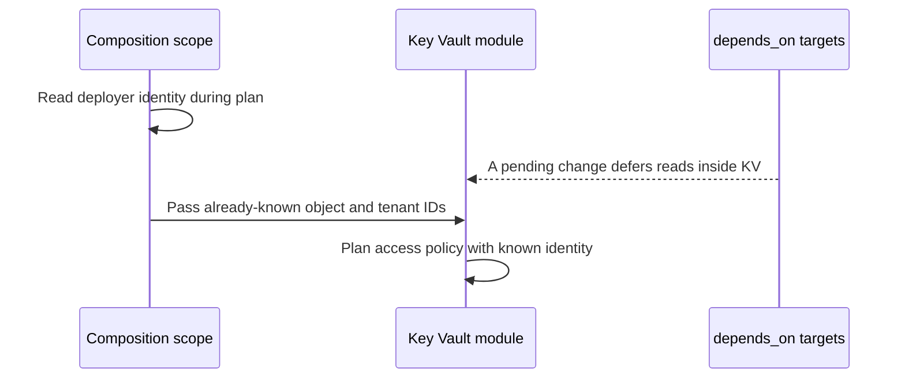

# 0009: Read the deployer identity outside depends_on

**Status:** Accepted  
**Date:** 2026-09-26  
**Code commit:** `0ca9c63afe42ba866bc0a9b748946448a699da2b`

## Context

A data source inside a module with module-level `depends_on` can be deferred until apply. If its value supplies an access-policy identity, the unknown value can cause replacement.

## Decision

Read the current deployer in the composition scope, which is outside the Key Vault module’s `depends_on`, and pass the IDs into that module.

## Consequences

The policy IDs stay known during planning. Adopters that pass explicit IDs must pass the object and tenant IDs together and keep them stable. They must not add a caller-level `depends_on` that defers the composition read.

## Code

- `modules/wordpress-site/main.tf:66-74` — reads and resolves the deployer identity in the composition scope.
- `modules/wordpress-site/main.tf:533-571` — passes the resolved IDs into the dependent Key Vault module.
