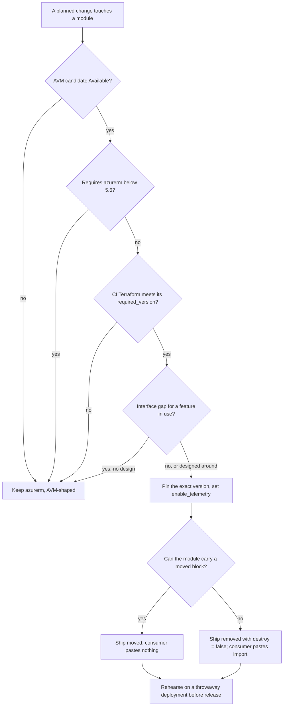

# Azure Verified Module adoption assessment

This page answers what adopting Azure Verified Modules (AVM) would take for each module in this repository, and which
modules can adopt one today. Read it before the first change that touches a module under the "migrate when touched"
rule of [ADR 0012](adr/0012-azure-verified-modules-first.md).

- **Check date:** 2026-11-13. Registry and documentation facts can change after it.
- **Commit measured:** `ce25ea4` (release 4.3.5).
- **Toolchains:** Terraform 1.9.8, which CI runs [L1], and Terraform 1.17.1 as a second column for a pending
  proposal to move CI to it.
- **Evidence:** every factual claim ends with a marker such as `[L1]`. The marker names a row of the
  [evidence ledger](avm-adoption-assessment-ledger.md), which holds the source and the exact text relied on. A sentence
  that starts with **Inferred:** is reasoning from the rows it cites, not a measurement. **UNKNOWN** means not measured.
- **Limits:** nothing here was planned or applied. The research ran `init -backend=false`, `validate`, `providers`,
  `fmt`, a static scan, and `terraform test` with mock providers only. No cloud credentials were used.

Contents: [Summary](#summary) · [Mapping table](#mapping-table) · [Toolchain matrix](#toolchain-matrix) ·
[Migration mechanics](#migration-mechanics) · [Key Vault RBAC](#key-vault-rbac) ·
[Spike and scanner results](#spike-and-scanner-results) · [Recommendation](#recommendation) ·
[Further recommendations](#further-recommendations) · [Corrections to existing guidance](#corrections-to-existing-guidance) ·
[UNKNOWN](#unknown)

## Summary

1. **Six of sixteen candidates cannot be composed with this tree.** MySQL, Key Vault, the Log Analytics workspace, the
   CDN profile, the Front Door WAF policy and the autoscale setting cap azurerm below 5 [L2] [L3] [L4] [L5] [L6] [L7],
   and every module here pins `~> 5.6` [L8]. The conflict was measured for the workspace on both toolchains, where
   `init` exits 1 [L9] [L337], and for MySQL and Key Vault on 1.17.1 [L328] [L584] [L332] [L585]. **Inferred:** the CDN
   profile, the WAF policy and the autoscale setting fail the same way; they were not run next to azurerm 5.
2. **Ten candidates require no azurerm.** Eight were initialised next to a module pinned `~> 5.6`. Six of them
   initialise on 1.9.8 [L295] [L299] [L308] [L312] [L10] [L318] and on 1.17.1 [L296] [L300] [L309] [L313] [L12] [L319],
   and the resource group module also validates on both [L11] [L13]. The other two need a newer CLI than CI runs:
   storage needs Terraform 1.10 [L14] and the network security group needs 1.11 [L15]. The action group and the
   activity-log alert were not run.
3. **Migration is simpler than the guidance says.** A `moved` block may cross a module package boundary since
   Terraform 1.3.0 [L16], so a module can carry the move and a consumer pastes nothing. `import` plus `removed` is the
   fallback.
4. **Key Vault is blocked, and its legacy switch does not keep this repository's model.** The AVM module defaults to
   Azure RBAC [L574] [L18]. With the switch on it owns the whole policy list [L19], and the app's policy cannot be
   passed in without a dependency cycle [L20]. A move to RBAC can be done on the bespoke module, without AVM.
5. **Static analysis stops at the module call.** CI does not read AVM module bodies [L21] [L22], and the pinned engine
   has no check for any azapi resource type [L23]. Telemetry is on by default [L555].

## Mapping table

### Candidates, measured on the check date

The version and date are from the registry API. `required_version` and the provider constraints are from the root
`terraform.tf` at the release tag. The index status is from the file the AVM resource index is built from.

| AVM candidate | Version (published) | Index status | `required_version` | Providers required | Resource type it manages |
| --- | --- | --- | --- | --- | --- |
| `avm-res-web-site` | 0.24.1 [L25] (2026-10-14 [L26]) | Available [L27] | `>= 1.9, < 2.0` [L28] | azapi `~> 2.12` [L29]; modtm `~> 0.3` [L30]; random [L31]; time [L32] | azapi [L33] |
| `avm-res-web-serverfarm` | 2.0.8 [L34] (2026-07-21 [L35]) | Available [L36] | `>= 1.9, < 2.0` [L37] | azapi `~> 2.4` [L38]; modtm `~> 0.3` [L39]; random `~> 3.5` [L40] | azapi [L41] |
| `avm-res-storage-storageaccount` | 0.11.0 [L42] (2026-11-04 [L43]) | Available [L44] | `>= 1.10.0` [L14] | azapi `~> 2.12` [L45] | azapi [L46] |
| `avm-res-network-virtualnetwork` | 0.23.0 [L47] (2026-11-04 [L48]) | Available [L49] | `>= 1.9, < 2.0` [L50] | azapi `~> 2.12` [L51] | azapi [L52] |
| `avm-res-network-privatednszone` | 0.6.0 [L53] (2026-11-05 [L54]) | Available [L55] | `>= 1.9, < 2.0` [L56] | azapi `~> 2.12` [L57]; time `~> 0.13` [L58] | azapi [L59] |
| `avm-res-resources-resourcegroup` | 0.5.0 [L60] (2026-11-06 [L61]) | Available [L62] | `>= 1.9, < 2.0` [L63] | azapi `~> 2.12` [L64] | azapi [L65] |
| `avm-res-insights-component` | 0.5.0 [L66] (2026-10-21 [L67]) | Available [L68] | `>= 1.9, < 2.0` [L69] | azapi `~> 2.12` [L70]; time `~> 0.13` [L71] | azapi [L72] |
| `avm-res-network-networksecuritygroup` | 0.6.0 [L73] (2026-10-07 [L74]) | Available [L75] | `>= 1.11, < 2.0` [L15] | azapi `~> 2.12` [L76]; modtm `~> 0.3` [L77]; random `~> 3.5` [L78]; time `~> 0.13` [L79] | azapi [L80] |
| `avm-res-insights-actiongroup` | 0.1.0 [L81] (2026-10-12 [L82]) | Available [L83] | `>= 1.9, < 2.0` [L84] | azapi `~> 2.12` [L85]; modtm `~> 0.3` [L86]; random `~> 3.5` [L87] | azapi [L88] |
| `avm-res-insights-activitylogalert` | 0.2.0 [L89] (2026-10-27 [L90]) | Available [L91] | `>= 1.9, < 2.0` [L92] | azapi `~> 2.12` [L93] | azapi [L94] |
| `avm-res-dbformysql-flexibleserver` | 0.1.9 [L95] (2026-11-06 [L96]) | Available [L97] | `>= 1.3.0 , < 2.0` [L98]; in practice 1.10 or later (see the matrix) | **azurerm `>= 4.55.0, < 5.0.0`** [L2]; azapi `~> 2.12` [L99]; time [L100] | azurerm and azapi [L101] |
| `avm-res-keyvault-vault` | 0.13.1 [L102] (2026-11-11 [L103]) | **Orphaned** [L104] | `>= 1.11, < 2.0` [L105] | **azurerm `>= 4.81, < 5.0`** [L3]; azapi `~> 2.12` [L106]; random [L107]; time [L108] | azapi for the vault [L109]; azurerm for secrets [L110] |
| `avm-res-operationalinsights-workspace` | 0.5.1 [L111] (2025-12-23 [L112]) | Available [L113] | `>= 1.9, < 2.0` [L114] | **azurerm `>= 4.36.0, < 5.0.0`** [L4]; azapi `~> 2.4` [L115]; modtm [L116]; random [L117]; time [L118] | azurerm [L119] |
| `avm-res-cdn-profile` | 0.2.0 [L120] (2026-11-11 [L121]) | Available [L122] | `>= 1.9, < 2.0` [L123] | **azurerm `~> 4.0`** [L5]; azapi `~> 2.12` [L124] | azurerm [L125] |
| `avm-res-network-frontdoorwebapplicationfirewallpolicy` | 0.1.1 [L126] (2026-09-01 [L127]) | Available [L128] | `>= 1.9, < 2.0` [L129] | **azurerm `>= 3.116.0, < 5.0`** [L6]; azapi `~> 2.4` [L130]; modtm [L131]; random [L132] | azurerm [L133] |
| `avm-res-insights-autoscalesetting` | 0.1.2 [L134] (2024-11-20 [L135]) | Available [L136] | `~> 1.5` [L137] | **azurerm `>= 3.116, < 5`** [L7]; modtm [L138]; random [L139] | azurerm [L140] |

Not published as modules:

- Metric alert and scheduled query rule are Proposed in the index [L141] [L142], and the registry returns 404 for
  both [L143] [L144]. The consumption budget is also Proposed [L145] [L146]; this repository declares none.
- The index has no row for an availability test, a standalone lock or a standalone diagnostic setting [L147], and the
  registry has no web-test module under the expected name [L148]. A resource module takes a lock and diagnostic settings
  as its own `lock` and `diagnostic_settings` inputs instead, as the Key Vault module does [L576] [L577]. Not every
  module has both: the autoscale module has no `lock` input [L553].
- The pattern index has no WordPress module [L149].

Why the bold constraints block: the `~>` operator lets only the right-most stated component grow [L150].
**Inferred:** `~> 5.6` is therefore the interval from 5.6.0 up to, not including, 6.0.0, and each bold constraint ends
at 5.0.0, so every intersection is empty. The registry holds azurerm 4.81.0 as the highest 4.x release [L151] and
5.13.0 as the highest 5.x release [L152].

### Per module

No resource in this repository uses azapi at this commit: a search of the tree for azapi resource and data blocks finds
none [L596], and the composition module says the same of itself in a comment [L153]. ForceNew hazards are from provider
documentation, because a mock cannot show replacement. For an azapi-based module the provider documents replacement for
`name` [L154] and `parent_id` [L155], and two arguments through which a module adds triggers of its own:
`replace_triggers_external_values` [L156] and `replace_triggers_refs` [L586]. The root `main.tf` of the Key Vault module
sets the first on its role-assignment resource [L587] [L588], and the root `main.tf` of the serverfarm module and of the
resource group module sets neither [L589] [L590]. The other files of those modules, and the other candidates, were not
read for this: UNKNOWN. So an azurerm ForceNew attribute does not say what the azapi-based module does on the same
change.

| Module | Resources and AVM candidate | Interface gaps | ForceNew hazards (azurerm documentation) | Verdict |
| --- | --- | --- | --- | --- |
| `networking` | Virtual network [L157] and subnets [L158]: virtual network module. Network security groups [L159] and their subnet associations [L160]: network security group module. | None found among the inputs compared: `subnets` [L612] with delegations [L613], service endpoints [L614] and a security group reference [L615]; `security_rules` on the security group module [L616]. A field-by-field comparison was not done: UNKNOWN. The virtual network module's `lock` has no `notes` [L161]. | Virtual network `name` [L162]; subnet `name` [L163]; security group `name` [L164]. | **Adopt on next touch** for the virtual network and subnets. The security groups follow once CI runs Terraform 1.11 or later [L15]; until then keep azurerm, AVM-shaped. |
| `dns-zones` | Private DNS zone [L165] and virtual network link [L166]: private DNS zone module. | None found among the inputs compared: `domain_name` [L617] and `virtual_network_links` [L618]. A field-by-field comparison was not done: UNKNOWN. `lock` has no `notes` [L167]. | Zone `name` [L168]; link `virtual_network_id` [L169]. | **Adopt on next touch.** |
| `database` | Flexible server [L170], configurations [L171], Entra administrator [L172], database [L173]: MySQL module. | The password `ignore_changes` [L174] cannot be passed in; the module offers a write-only password [L175]. | `administrator_login` [L176]; `delegated_subnet_id` [L177]; `geo_redundant_backup_enabled` [L178]; `private_dns_zone_id` [L179]; shrinking `size_gb` [L180]; database `charset` [L181]. | **Blocked by provider major** [L2]. |
| `storage` | Storage account [L182], containers [L183], management policy [L184]: storage account module. | No feature gap found. Defaults to override: shared-key access is off [L185] and this repository needs it on [L186]; public network access [L187]; infrastructure encryption off [L188] against on here [L189]; replication [L190]. Last-access tracking has no input of this repository's name [L191] [L192]. `lock` has no `notes` [L193]. | Account `name` [L194]; `account_tier` [L195]; zonal replication change [L196]; `infrastructure_encryption_enabled` [L197]; container `name` [L198]. | **Adopt on next touch, once CI runs Terraform 1.10 or later** [L14]. On 1.9.8: keep azurerm, AVM-shaped. |
| `key-vault` | Vault [L199], access policies [L200], secret [L201]: Key Vault module. | Default is RBAC [L574] [L18] and this repository uses access policies [L202]. Defaults to set: SKU [L203] [L204], purge protection on [L205] [L206]. `lock` has no `notes` [L207]. See [Key Vault RBAC](#key-vault-rbac). | Vault `name`, and a recoverable vault must be purged first [L208]; purge protection cannot be disabled [L209]; retention is set once [L210] [L211]; policy `key_vault_id` [L212]; secret `name` [L213]. | **Blocked by provider major** [L3]. Also needs Terraform 1.11 [L105], and is Orphaned in the index [L104]. |
| `app-service` | Plan [L214]: serverfarm module. Web app [L215] and slot [L216]: web-site module. Autoscale setting [L217]: autoscale module. | (1) No `health_check_eviction_time_in_min` input [L218]; the app and the slot set it [L219] [L220]. (2) No equivalent for ignoring one app-setting key [L221]: app settings are a submodule on an update resource [L222], where a non-empty `ignore_body_changes` fails the plan [L223]. (3) The WebDeploy flag has another name [L224] [L225]. (4) TLS, FTPS and SCM restriction defaults are `optional()` attributes of `site_config` [L226] [L227] [L232]. Present, so not gaps: sticky settings [L228], slot identity [L229] [L230], SCM restrictions [L231] [L232], the Front Door ID header [L233]. Plan defaults differ from this repository's and must be set: zone balancing is on [L234] and nothing here sets it [L597]; the worker count is 3 [L235] against 1 here [L598]; the SKU is `P1v2` [L236] against `P1v3` here [L599]. | Plan `name` [L238], `os_type` [L237]; app `name` [L239], `resource_group_name` [L240]; slot `name` [L241]; autoscale `target_resource_id` [L242]. | **Adopt on next touch** for the plan, app and slot, after designing around gaps 1 and 2. Autoscale setting: **blocked by provider major** [L7]. |
| `monitoring` | Workspace [L243]: workspace module. Component [L244]: component module. Action group [L245]: action group module. Metric alerts [L246]: none. Diagnostic settings [L247]: none standalone. | None found among the inputs compared: the workspace's SKU [L619] and retention [L620]; the component's `workspace_id` [L621], `application_type` [L622] and `retention_in_days` [L623]; the action group's `email_receivers` [L624]. A field-by-field comparison was not done: UNKNOWN. | Workspace `name` [L248], most `sku` changes [L249]; component `name` [L251], `application_type` [L250]; action group `name` [L252]. | **Keep azurerm, AVM-shaped.** Workspace blocked by provider major [L4]. Component and action group are adoptable on a touch. |
| `front-door` | Profile [L253], endpoint [L254], origin group [L602], origins [L255], routes [L256], custom domain [L257] and its association [L603], security policy [L258], rule set [L604], rules [L259]: CDN profile module, whose registry record lists the origin group, association and rule set types [L605] [L606] [L607]. Firewall policy [L260]: CDN profile module or WAF policy module. | Field-by-field comparison not done: UNKNOWN. | Profile `sku_name` [L261]; endpoint `name` [L262]; custom domain `host_name` [L263]; firewall policy `sku_name` [L264]. | **Blocked by provider major** [L5] [L6]. |
| `shared-infrastructure` | Resource group [L265]: resource group module. Plan [L266]: serverfarm module. Autoscale setting [L267]: autoscale module. Lock [L268]: the resource group module's `lock` input. | The resource group module's `lock` takes `kind` and `name` only [L269], so this repository's `notes` text [L270] would not pass through. | Resource group `name` [L271]; lock `lock_level` [L272] and `notes` [L273]; plan as above. | **Adopt on next touch** for the resource group and plan. Autoscale setting: **blocked by provider major** [L7]. |
| `wordpress-site` | Its own resource group [L274], workspace [L275], component [L276], access policies [L277], action group [L278], metric alerts [L279], scheduled query rule [L280], activity-log alert [L281], web test [L282], hostname binding [L283], lock [L284], diagnostic settings [L285], one MySQL server configuration [L608]; and the calls to the modules above [L286] [L287]. | Hostname binding and the activity-log alert condition were not compared in detail: UNKNOWN. The Front Door ID restriction is a plain header rule on the app [L288], not an update resource. | Hostname binding `hostname` [L289]; activity-log alert `name` [L290]; the rest as in the rows above. | **Keep azurerm, AVM-shaped**; each resource follows its own row. Adoptable on a touch: resource group, component, action group, activity-log alert. No module: metric alerts, query rule, web test. The MySQL configuration follows the `database` row. |
| `cloudflare` | Cloudflare resources only [L291]. | Not applicable. | Not applicable. | **Not applicable.** |

The issue's four verdicts have no value for "azapi-only, but the Terraform floor is above CI". This page reports those
two cases (storage, network security groups) as "adopt on next touch" with the condition stated.

## Toolchain matrix

"Alone" is a root that holds only the module call, initialised with `init -backend=false`. "Next to azurerm 5" adds
this repository's key-vault module, which requires azurerm `~> 5.6` [L292].

| Candidate | Alone, 1.9.8 | Alone, 1.17.1 | Next to azurerm 5, 1.9.8 | Next to azurerm 5, 1.17.1 |
| --- | --- | --- | --- | --- |
| web-site 0.24.1 | init 0 [L293] | init 0 [L294] | init 0 [L295] | init 0 [L296] |
| serverfarm 2.0.8 | init 0 [L297] | init 0 [L298] | init 0 [L299] | init 0 [L300] |
| storage account 0.11.0 | init 1, CLI floor [L301] [L578] | init 0 [L302] | init 1, CLI floor [L579] [L580] [L303] | init 0, validate 0 [L304] [L305] |
| virtual network 0.23.0 | init 0 [L306] | init 0 [L307] | init 0 [L308] | init 0 [L309] |
| private DNS zone 0.6.0 | init 0 [L310] | init 0 [L311] | init 0 [L312] | init 0 [L313] |
| resource group 0.5.0 | init 0 [L314] | init 0 [L315] | init 0, validate 0 [L10] [L11] | init 0, validate 0 [L12] [L13] |
| component 0.5.0 | init 0 [L316] | init 0 [L317] | init 0 [L318] | init 0 [L319] |
| network security group 0.6.0 | init 1, CLI floor [L320] [L581] [L322] | init 0 [L321] | init 1, CLI floor [L323] | init 0 [L324] |
| MySQL 0.1.9 | init 1 [L325] | init 0 [L326] | init 1, the module does not load [L327] [L346] | init 1, azurerm cap [L328] [L584] |
| Key Vault 0.13.1 | init 1, CLI floor [L329] [L582] | init 0 [L330] | init 1, CLI floor [L331] [L583] [L502] | init 1, azurerm cap [L332] [L585] |
| workspace 0.5.1 | init 0 [L333] | init 0 [L334] | init 1, azurerm cap [L335] [L9] [L500] | init 1, azurerm cap [L336] [L337] [L501] |
| CDN profile 0.2.0 | init 0 [L338] | init 0 [L339] | not run | not run |
| WAF policy 0.1.1 | init 0 [L340] | init 0 [L341] | not run | not run |
| autoscale setting 0.1.2 | init 0 [L342] | init 0 [L343] | not run | not run |
| action group 0.1.0, activity-log alert 0.2.0 | not run | not run | not run | not run |

Reading it:

- **Minimum CLI.** Storage needs 1.10 [L14]; Key Vault and the network security group need 1.11 [L105] [L15]. The MySQL
  module declares `>= 1.3.0` [L98] but uses an ephemeral input variable [L344], which needs Terraform 1.10 or later
  [L345], and it fails to load on 1.9.8 [L346]. Its declared floor is wrong; the exact minimum was not bisected. Every
  other initialised candidate loads on 1.9.8. The action group and the activity-log alert were not run on either
  toolchain. All fourteen initialised candidates load on 1.17.1.
- **Inferred:** the CDN profile, WAF policy and autoscale setting fail next to azurerm 5 on both toolchains, from
  their constraints [L5] [L6] [L7] and the `~>` rule [L150]. The action group and activity-log alert need
  Terraform 1.9 and azapi only [L84] [L85] [L92] [L93], so they should load on both; neither was run.
- **modtm and azapi resolve on both toolchains.** Runs that needed them installed azapi 2.13.0 [L347] [L348] and
  modtm 0.4.0 [L349] [L350], the highest versions the registry lists [L351] [L352].
- **modtm is no longer universal.** Of the sixteen candidates, seven declare it: web-site [L30], serverfarm [L39],
  workspace [L116], network security group [L77], WAF policy [L131], autoscale setting [L138] and action group
  [L86].
- **A second module package arrives with most candidates.** Five of the candidates read call a shared interfaces
  utility module at an exact version [L353] [L354] [L355] [L356] [L357]. The resource group module's random
  requirement comes from it, not from the module's own file [L358] [L359].

What a consumer's lock file gains, measured from the spike's lock files:

| Root | Lock file providers |
| --- | --- |
| This repository's module alone | azurerm 5.13.0 [L360] |
| Plus resource group 0.5.0 | adds azapi with floor 2.12 [L361] and random with floor 3.6 [L362]; no modtm |
| Plus serverfarm 2.0.8 | adds azapi [L363], modtm with floor 0.3 [L364] and random [L365] |

The composition module already constrains azapi to `>= 1.13.0, < 3.0` [L366], random to `>= 3.5.0, < 4.0` [L367] and
time to `>= 0.9.0, < 1.0` [L368]. **Inferred:** adopting a candidate that requires azapi `~> 2.12` raises a consumer's
azapi floor to 2.12 within major 2, and one that requires time `~> 0.13` raises the time floor from 0.9 to 0.13.
Composition against the composition module itself was not initialised: UNKNOWN. **Inferred:** every adopting module's
`required_version` would rise from 1.6.0 [L369] to at least 1.9, the lowest floor among the azapi-only candidates [L28].

## Migration mechanics

### Where each block may appear

| Block | Root module | Child module | Across module packages |
| --- | --- | --- | --- |
| `moved` | yes [L389] | yes; it may name the module's own objects and those of the modules it calls [L370] | yes since 1.3.0 [L16]; rejected in 1.2 [L371] |
| `import` | yes [L372] | no on 1.9.8 [L373] [L374]; yes from 1.16.0 [L375], validated on 1.17.1 [L376] | the `to` address may reach a module from another package, validated on 1.17.1 [L377] [L378] |
| `removed` | yes [L600] | yes: validates in a child module on both toolchains [L379] [L380]. No official statement on placement was found: the block's reference page names neither root nor child modules [L601], and the 1.7.0 changelog addresses module authors without limiting the block to a root module [L600] | not probed: UNKNOWN |

`validate` is weak evidence for `removed`: it also accepts a `removed` block whose resource is still declared [L381].
The cross-package `moved` was shown with state on 1.17.1: after applying the new layout, the same object ID sits at the
address inside the other package, for a `for_each` site key [L382] [L383] [L384]. A control without the block recreated
the objects [L385]. On 1.9.8 it was shown at plan level only [L386] [L387]. The probes use stand-in resources behind a
mock provider.

### Minimum versions

| Feature | Minimum |
| --- | --- |
| `moved` block | Terraform 1.1 [L388] [L389] |
| `moved` across module packages | Terraform 1.3.0 [L16] |
| `moved` across resource types | Terraform 1.8.0, and only where the target provider supports the pair [L390] [L391] |
| `import` block | Terraform 1.5.0 [L392] |
| `import` with an expression as `id` | Terraform 1.6.0 [L393] |
| `for_each` on `import` | Terraform 1.7.0 [L394] |
| `import` in a child module | Terraform 1.16.0 [L375] |
| `removed` block, with `lifecycle { destroy = false }` | Terraform 1.7 [L395] [L396] |
| azurerm type to `azapi_resource` by `moved` | azapi 2.1.0 [L397] [L398] and Terraform 1.8.0 [L399] |

Rules that shape a migration:

- Addresses in a `moved` block are relative to the module that holds it [L400], so a block in the composition module
  needs no site key. A move into a module call that uses `count` or `for_each` must name the instance key [L401].
- A shipped `moved` block must stay in later releases: removing it is a breaking change [L402].
- A cross-type move fails where the target provider does not support it [L403]. azapi accepts a move only from an
  azurerm resource type into `azapi_resource` [L404]; the reverse direction is not supported [L405]. It converts the
  azurerm ID generically for most types [L406]. Whether that conversion succeeds for each type this repository uses is
  UNKNOWN. azapi 2.12.0 fixed a defect in these moves [L407].
- **A caller's `moved` can clash with one the AVM module ships.** The serverfarm module carries its own `moved` from
  `azurerm_service_plan.this` to `azapi_resource.this` [L408]. A whole-resource `moved` from the caller into the same
  target fails with "Ambiguous move statements" on both toolchains [L409] [L410]. Chaining through the address the AVM
  module moves on from works [L411] [L412].
- The `from` of a `removed` block names the whole resource, with no instance key [L413]. After `removed`, the object
  comes back under management only through an import [L414].
- An import target must be declared in configuration [L415], and the ID [L416] and the `for_each` collection [L417]
  must be known at plan time.

### Decision path



### Worked example (a): an azurerm-based AVM target

Target: the workspace module, which manages `azurerm_log_analytics_workspace.this` [L119]. It caps azurerm below 5.0.0
[L418], so this shows the mechanics for the day the cap moves. Old address: `azurerm_log_analytics_workspace.main[0]`
in the composition module [L419] [L420].

Preferred: the composition module carries the move, and the consumer adds nothing.

```hcl
module "log_analytics" {
  count   = local.create_workspace ? 1 : 0
  source  = "Azure/avm-res-operationalinsights-workspace/azurerm"
  version = "0.5.1"

  # (module inputs omitted)
}

moved {
  from = azurerm_log_analytics_workspace.main[0]
  to   = module.log_analytics[0].azurerm_log_analytics_workspace.this
}
```

Fallback: the module forgets the resource and the consumer's root imports it. The multi-site example calls the
composition as `module.wordpress_sites` [L421] with `for_each` [L422]. The import ID is the Azure resource ID [L423].

```hcl
# Module side
removed {
  from = azurerm_log_analytics_workspace.main

  lifecycle {
    destroy = false
  }
}
```

```hcl
# Consumer root
locals {
  log_analytics_workspace_ids = {
    site_one = "/subscriptions/<subscription>/resourceGroups/<resource group>/providers/Microsoft.OperationalInsights/workspaces/<workspace name>"
  }
}

import {
  for_each = local.log_analytics_workspace_ids
  to       = module.wordpress_sites[each.key].module.log_analytics[0].azurerm_log_analytics_workspace.this
  id       = each.value
}
```

### Worked example (b): an azapi-based AVM target

Target: the serverfarm module, which manages `azapi_resource.this` [L41] and requires Terraform 1.9 [L424] and azapi
`~> 2.4` [L425]. Old addresses: `azurerm_service_plan.main[0]` in the app-service module [L426] [L427] and
`azurerm_service_plan.shared` in the shared-infrastructure module [L428].

Per-site plan, where the module call uses `count`. The instance-keyed statement passes move validation next to the AVM
module's own block [L429] [L430]. Whether it also carries state through is UNKNOWN: only the chained form was shown
with state.

```hcl
module "plan" {
  count   = local.create_plan ? 1 : 0
  source  = "Azure/avm-res-web-serverfarm/azurerm"
  version = "2.0.8"

  # (module inputs omitted)
}

moved {
  from = azurerm_service_plan.main[0]
  to   = module.plan[0].azapi_resource.this
}
```

Shared plan, where the module call has no `count`. The target is the address the AVM module itself moves on from
[L408]; naming `module.plan.azapi_resource.this` here is the ambiguous case [L409].

```hcl
moved {
  from = azurerm_service_plan.shared
  to   = module.plan.azurerm_service_plan.this
}
```

Fallback: the same `removed` block as in example (a), with `from = azurerm_service_plan.main`, and a consumer import.
The path runs through the composition's `module.app_service` call [L431], and the import ID of `azapi_resource` is the
Azure resource ID, optionally with an API version [L432].

```hcl
import {
  for_each = local.service_plan_ids
  to       = module.wordpress_sites[each.key].module.app_service.module.plan[0].azapi_resource.this
  id       = each.value
}
```

The example files pass `terraform fmt -check` on both toolchains [L433] [L434], with failing controls [L435]. They
name registry modules and real providers, so they were not initialised.

### Consumer upgrade-note template

For a release that carries the move itself:

> **State migration.** This release moves `<old address>` into `<new address>`. The module carries the `moved` block;
> add nothing to your root.
>
> 1. Use Terraform `<floor>` or later and run `terraform init -upgrade`. The release adds the providers `<list>` to
>    your lock file.
> 2. Run `terraform plan`. For each site expect one line saying `<old address>` has moved to `<new address>`, and no
>    create, destroy or replace for that resource. Stop and report if the plan shows anything else for it.
> 3. Apply.

For a release that cannot carry the move, the consumer pastes this block and fills the placeholders:

```hcl
locals {
  # Site keys must be the keys of the for_each on the composition module call.
  # List only the sites that actually have the resource.
  migrated_resource_ids = {
    "<site key>" = "<Azure resource ID of that site's resource>"
  }
}

import {
  for_each = local.migrated_resource_ids
  to       = module.wordpress_sites[each.key].module.EXAMPLE_CALL.EXAMPLE_TYPE.this
  id       = each.value
}

# A root that calls the composition module once, without for_each, pastes a
# single block without for_each instead:
#
# import {
#   to = module.wordpress_site.module.EXAMPLE_CALL.EXAMPLE_TYPE.this
#   id = "<Azure resource ID>"
# }
```

> 1. Use Terraform 1.7 or later. Paste the block into your root before the first plan of the new version.
> 2. Run `terraform plan`. For each site expect the old address reported as no longer managed (not destroyed) and the
>    new address reported as imported. Stop if the plan shows a create or a destroy for the resource.
> 3. Apply, then delete the pasted block [L436].

The release note must name the module call, the resource type and any instance key of the real target.

## Key Vault RBAC

### Today

The vault has RBAC authorization off [L437]. The key-vault module writes the deployer's access policy [L438]. The
composition writes the app's policy [L439] and the slot's policy [L440] itself, because those identities exist only
after the app does [L441]. ADR 0005 records the choice [L442].

### What the AVM module does

- The switch `legacy_access_policies_enabled` selects access policies and prevents data-plane RBAC [L17]. It defaults to
  false [L574], and the vault's RBAC flag is its negation [L18]. With the switch off the module does not manage access
  policies at all [L488]. A mock test of the module at 0.13.1 passed [L609] and confirmed that the default plans RBAC
  [L443] [L610].
- With the switch on, the vault stays on access policies [L444] [L611], and the body's policy list is exactly the
  `legacy_access_policies` input [L445]. The module then owns the list: a write resets what it omits [L19].
- Since 0.13.0 the vault is an azapi resource: `main.tf` opens with an azurerm vault at 0.12.0 [L591], and with an azapi
  resource at 0.13.0 [L592] and at 0.13.1 [L109]. The policies are no longer separate resources: 0.13.0 added a
  `removed` block for them [L593], and 0.13.1 keeps it [L446].
- Passing only the deployer's policy in validates [L447]. Passing the app identity's policy in is a dependency cycle:
  `validate` exits 1 [L20]. The same holds for the app's role assignment on the RBAC path [L448].
- Keeping the app and slot policies as separate resources beside the module conflicts with an owned list, by the
  provider's documentation [L449]. The live effect is UNKNOWN.

So `legacy_access_policies_enabled = true` preserves the permission model, not the way this repository manages the
policies. The module is blocked in any case: `init` fails on 1.9.8 [L450], and on 1.17.1 it resolves azurerm 4.81.0
only [L451].

### What a switch to RBAC requires

| Need | Built-in role | Rows |
| --- | --- | --- |
| Create role assignments on the vault | Owner, User Access Administrator, Role Based Access Control Administrator, or Key Vault Data Access Administrator | [L452] [L453] [L454] |
| Change the vault's permission model | Owner, or User Access Administrator together with Key Vault Contributor | [L455] [L456] [L457] |
| Deployer: write, delete, purge and recover secrets | Key Vault Secrets Officer | [L458] [L459] |
| Web app identity and slot identity: read secrets | Key Vault Secrets User | [L460] [L461] |

- Contributor cannot create role assignments [L462], and Key Vault Data Access Administrator is not enough to change
  the permission model [L463].
- Under access policies, a principal with vault write can grant itself data access with no role-assignment right
  [L464]. **Inferred:** that is why today's model works for a deployer principal that may not create role
  assignments, and why RBAC needs either a deployer that may, or a separately privileged administrator for the
  assignments and the model change.
- Two Microsoft pages disagree on the model change. The RBAC guide and the provider documentation require unrestricted
  role-assignment write [L455] [L457]; another page says vault write is enough and the stricter right is a portal
  requirement [L465]. Which holds for an API caller is UNKNOWN. Plan for the stricter reading.
- The switch invalidates every access policy at once [L466]. Microsoft's order is role assignments first, then the
  switch [L467].
- Propagation: up to 10 minutes for a role assignment [L468], and several hours through a group for a managed
  identity [L469] [L470]. Assign to the identities directly.
- App Service refetches Key Vault references every 24 hours, and at once on any configuration change [L471]. A
  reference that fails to resolve hands the app the literal reference string [L472]. **Inferred:** an app left without
  a role can look healthy on cached values and fail at its next refetch, so a cut-over check must force a refetch on
  the app and on the slot.
- The permission-model change is an in-place update in the provider [L473]. **Inferred:** in one apply Terraform
  would change the vault first and create the vault-scoped role assignments afterwards, leaving an interval with no
  data access. The assignments therefore ship in an earlier release than the switch.

### The deployer-ID inputs

`deployer_object_id` feeds the `object_id` of the deployer policy today [L474], and `deployer_tenant_id` feeds its
`tenant_id` [L475]. ADR 0009 requires the identity to be read outside `depends_on` [L476].

- **RBAC path.** **Inferred:** `deployer_object_id` becomes the principal of the Key Vault Secrets Officer assignment.
  A changed `principal_id` forces a new role assignment [L477], so ADR 0009's rule stays. `deployer_tenant_id` has
  nothing to feed, because a role assignment takes a principal, not a tenant [L477].
- **AVM legacy path.** The object ID becomes one entry of the inline policy list [L445], and every policy carries the
  vault's tenant [L478], so `deployer_tenant_id` has no use there either.

### One-way settings

| Setting | Rule |
| --- | --- |
| Purge protection | Can be turned on, never off [L479] [L480] |
| Soft-delete retention days | Fixed at creation [L481] [L482] |
| Soft delete itself | Cannot be disabled [L483] |
| Name of a deleted vault | Held until the retention window ends [L484] [L485] |
| Recovery | The provider recovers a same-named soft-deleted vault by default [L486]; a recovered vault comes back without its role assignments [L487] |
| Permission model | Changed in place [L473]; whether access policies take effect again after a switch back is UNKNOWN |

Under the AVM module, purge protection defaults to on [L206] and is described as irreversible [L489], where this
repository's nonprod default is off [L490]. Retention defaults to unset [L575]; the input's description names 90 days as
the default [L491]. Pass both explicitly in any later adoption.

### Ordered cut-over on the bespoke module

Written for one site; a consumer repeats it per site key.

**Release A: prepare, with no behaviour change**

1. Decide who assigns roles: the deployer holds Role Based Access Control Administrator, User Access Administrator or
   Owner on the vault's scope, or a separate administrator performs steps 4, 5 and 9 [L452] [L453].
2. Inventory the vault's access policies against the three the modules manage. Any other principal loses access at the
   switch [L466].
3. Keep the deployer read at composition scope [L476] [L492].
4. Assign the deployer **Key Vault Secrets Officer** on the vault [L458].
5. Assign **Key Vault Secrets User** on the vault to the web app's system-assigned identity and, where the slot
   exists [L493], to the slot's identity [L460]. Set the principal type to ServicePrincipal [L494].
6. Apply, leaving `rbac_authorization_enabled = false` [L437] and all three policies in place. The new roles do nothing
   yet [L495]. Wait at least 10 minutes [L468].

**Release B: switch**

7. Confirm the three assignments exist and that the vault's firewall still admits the deployer and the app subnet.
8. Confirm the right to change the permission model: Owner, or User Access Administrator with Key Vault Contributor
   [L455] [L456].
9. Set `rbac_authorization_enabled = true` and stop managing the three access policies, preferably by dropping them
   from state without deleting them, as the AVM module does on its own upgrade [L446].
10. Apply in a quiet window: every access policy is invalidated immediately [L466].
11. Restart the app and the slot so references are refetched now [L471]. Check that no setting holds the literal
    reference string [L472] and that a plan as the deployer reads every secret.
12. Monitor for access issues [L496], for at least 24 hours so that every reference has been refetched once
    [L471].

**Release C: clean up**

13. Remove the leftover access policies and update ADR 0005, the security model page and the guidance file.

Rollback before step 13 is to set the flag back to false. It relies on Azure honouring the leftover policies again,
which is UNKNOWN. New sites after the cut-over need an explicit wait between the deployer's assignment and the first
secret write; the AVM module's own wait is 30 seconds [L497], well under the 10 minute bound [L468].

## Spike and scanner results

### Spike (a): an azapi-only module next to azurerm 5

Root: this repository's key-vault module plus the resource group module 0.5.0. Abridged output on Terraform 1.9.8
[L498]:

```text
- Finding hashicorp/azurerm versions matching "~> 5.6"...
- Finding azure/azapi versions matching "~> 2.12"...
- Finding hashicorp/random versions matching "~> 3.6"...
- Installed hashicorp/azurerm v5.13.0 (signed by HashiCorp)
- Installed azure/azapi v2.13.0 (signed by a HashiCorp partner, key ID 6F0B91BDE98478CF)
- Installed hashicorp/random v3.9.1 (signed by HashiCorp)
Terraform has been successfully initialized!
### init exit code: 0
Success! The configuration is valid.
### validate exit code: 0
```

The result is the same on 1.17.1 [L499] [L12] [L13]. A second azapi-only module, serverfarm 2.0.8, also
initialises on both [L299] [L300].

### Spike (b): the expected conflict

Root: the same module plus the workspace module 0.5.1. Abridged output on 1.9.8 [L500] [L335] [L9]; the wording
is the same on 1.17.1 [L501] [L336]:

```text
- Finding hashicorp/azurerm versions matching ">= 4.36.0, < 5.0.0, ~> 5.6"...
Error: Failed to query available provider packages

Could not retrieve the list of available versions for provider
hashicorp/azurerm: no available releases match the given constraints >=
4.36.0, < 5.0.0, ~> 5.6
### init exit code: 1
```

The CLI floor error, Key Vault module on 1.9.8 [L502]:

```text
Error: Unsupported Terraform Core version

  on <scratch>\tfdata\b-kv-1.9.8\modules\avm_key_vault\terraform.tf line 2, in terraform:
   2:   required_version = ">= 1.11, < 2.0"

Module module.avm_key_vault (from
registry.terraform.io/Azure/avm-res-keyvault-vault/azurerm) does not support
Terraform version 1.9.8. To proceed, either choose another supported
Terraform version or update this version constraint. Version constraints are
normally set for good reason, so updating the constraint may lead to other
errors or unexpected behavior.
### init exit code: 1
```

The spike and the migration probes ran in scratch directories outside the repository, and their data directories and
lock files were deleted afterwards.

### Scanner check

The scans used the engine version that CI's pinned action runs, 3.4.3 [L503] [L504], with CI's skip list [L505], render
count [L506] and policy file, which turns external-module download off [L21].

| Run | Root holds | Module download | Exit | Resources | Passed | Failed | Skipped | Unknown |
| --- | --- | --- | --- | --- | --- | --- | --- | --- |
| c0 [L507] | local key-vault module | off (CI) | 0 | 4 | 3 | 0 | 1 | 0 |
| c1 [L22] | plus resource group 0.5.0 | off (CI) | 0 | 4 | 3 | 0 | 1 | 0 |
| c2 [L508] | plus resource group 0.5.0 | on | 0 | 14 | 3 | 0 | 1 | 0 |
| c3 [L509] | plus MySQL 0.1.9 | off (CI) | 0 | 4 | 3 | 0 | 1 | 0 |
| c4 [L510] | plus MySQL 0.1.9 | on | 1 | 18 | 4 | 1 | 1 | 0 |
| c5 [L511] | local storage module | off (CI) | 1 | 4 | 11 | 1 | 0 | 0 |
| c9 [L512] | plus storage account 0.11.0 | off (CI) | 1 | 4 | 11 | 1 | 0 | 0 |
| c8 [L513] | plus storage account 0.11.0 | on | 1 | 104 | 11 | 1 | 0 | 0 |
| c6 [L514] | storage account 0.11.0 only | off (CI) | 0 | 0 | 0 | 0 | 0 | 0 |
| c7 [L515] | storage account 0.11.0 only | on | 0 | 0 | 0 | 0 | 0 | 0 |

- **With and without the AVM call, under CI settings, nothing changes:** the same result sets and the same resource
  count (c0 against c1 and c3; c5 against c9). The baselines are not empty, so this is not an empty-against-empty
  comparison. An init module cache in the root does not change it [L516].
- **Security defaults inside an AVM module are not evaluated in CI.** The scanner's documentation says coverage inside
  external modules needs the download option [L517] [L518].
- **With download forced on, an azapi-based module is parsed and still gets no result.** The engine registers no
  attribute check for any azapi resource type [L519] [L23], and no check file mentions azapi [L520], against 299
  check files for azurerm types [L521].
- **With download forced on, an azurerm-based module is evaluated.** The MySQL run adds one failed check [L522] and
  no derived unknown [L523]. The failure is CKV_AZURE_53, which the guidance file already records as a false positive
  [L524]; the AVM module sets the newer argument [L525] with a default of `Disabled` [L526].
- **Inferred:** moving this repository's storage module to the azapi-based AVM module would remove its evaluated
  results (11 passed and 1 failed in c5) without turning any of them into a failure, because the same scan of the AVM
  module alone is empty (c6, c7) and the engine registers 10 attribute checks for the azurerm storage account type
  only [L527]. CI would stay green and say nothing.

"Unknown" is derived, not reported by the scanner: the attribute checks registered for each reported resource type,
minus the skip list, minus the reported results. The one failed result in c5, c9 and c8 is CKV_AZURE_43 on
`module.local_storage.azurerm_storage_account.main` [L511] [L512] [L513], which is this repository's own storage module
with the spike's placeholder inputs; why it fails there, and whether it fails in CI's root scan, is UNKNOWN. The one
failed result in c4 is CKV_AZURE_53 on `module.avm_mysql.azurerm_mysql_flexible_server.this` [L510].

## Recommendation

### Verdict per module

| Module | Verdict |
| --- | --- |
| `networking` | Adopt on next touch; security groups once CI runs Terraform 1.11 or later |
| `dns-zones` | Adopt on next touch |
| `database` | Blocked by provider major |
| `storage` | Adopt on next touch once CI runs Terraform 1.10 or later; until then keep azurerm, AVM-shaped |
| `key-vault` | Blocked by provider major; also a design change, not an input mapping |
| `app-service` | Adopt on next touch for plan, app and slot, after the two gaps are designed around; autoscale blocked by provider major |
| `monitoring` | Keep azurerm, AVM-shaped; component and action group adoptable |
| `front-door` | Blocked by provider major |
| `shared-infrastructure` | Adopt on next touch for resource group and plan; autoscale blocked by provider major |
| `wordpress-site` | Keep azurerm, AVM-shaped; each own resource follows its candidate |
| `cloudflare` | Not applicable |

The reasons and their ledger rows are in the [per-module table](#per-module).

### Re-assessment triggers

- A release of the MySQL, Key Vault, workspace, CDN profile, WAF policy or autoscale module whose azurerm constraint
  admits 5.6, or that drops azurerm.
- CI moving to Terraform 1.10 or later (storage, MySQL) or 1.11 or later (network security group, Key Vault).
- The metric-alert or scheduled-query-rule module leaving Proposed.
- The Key Vault module leaving Orphaned, moving its secrets to azapi, or accepting outside policies in legacy mode.
- A scanner release that adds checks for azapi resource types.
- A new major of any candidate, which the weekly dependency-update run can surface once a module is pinned.

### Pinning policy for 0.x modules

Pin an exact `version` on every AVM module call, as ADR 0012 already requires. The measurements show why a range is
unsafe: the Key Vault module changed its resource model between 0.12.0 [L591] and 0.13.0 [L592], a minor release, and
its azurerm cap moved down from the `< 5.1` the guidance recorded [L528] to `< 5.0` [L3]. The AVM modules pin their own
utility module exactly [L353]. A chained `moved` depends on the pinned release keeping its own `moved` block [L408].
Review the module's `terraform.tf`, its `moved` and `removed` blocks and its defaults on every bump.

### Does the `lock` input match the AVM shape?

Yes for the type. The AVM interface is an object with `kind`, optional `name` and optional `notes`, default null
[L529] [L530] [L531] [L532] [L533]. Both modules here declare the same three attributes [L534] [L535] [L536]
[L537] [L538] [L270] with a null default [L539] [L540]. This repository narrows `kind` to `CanNotDelete` on
purpose [L541] [L542].

The modules lag the interface. Four of the measured modules declare `notes`: network security group [L543], component
[L544], action group [L545] and activity-log alert [L546]. Eleven declare `kind` and `name` only: web-site [L547],
serverfarm [L548], MySQL [L549], private DNS zone [L167], CDN profile [L550], WAF policy [L551], Key Vault
[L207], workspace [L552], virtual network [L161], resource group [L269] and storage [L193]. The autoscale module
has no `lock` input [L553]. Terraform discards extra attributes when it converts to an object type that lacks them
[L554]. **Inferred:** passing this repository's object into one of the eleven is accepted with `notes` dropped
silently; that was not run. The resource group module is one of the eleven, and both of this repository's locks would
land there, so the `notes` text would not reach Azure.

## Further recommendations

### Telemetry

`enable_telemetry` defaults to true [L24] [L555], and the AVM specification requires that default and the off switch
[L556] [L557]. In the resource group module 0.5.0 it creates an empty deployment at subscription scope through azapi
[L558] [L559]; the older modtm mechanism is removed there [L560], while serverfarm 2.0.8 still uses modtm [L561]. With
telemetry on, the deploying principal needs deployment rights at subscription scope [L562].

**Recommendation:** set `enable_telemetry = false` on every AVM module call by default, and expose one pass-through
input on a wrapping module, as the specification asks of modules that wrap AVM modules [L563]. **Inferred:** a
deployer whose rights stop at a resource group would otherwise fail on the telemetry deployment, which is the same
kind of question as whether the deployer may create role assignments.

### Does the "security defaults as top-level variables" rule survive?

It survives for this repository's own inputs, and it stops helping at the AVM boundary. **Inferred:** a wrapper can
still keep its security inputs flat, but the value then flows into an AVM module that CI does not read [L21] [L22] and,
for an azapi-based module, into resource types the engine has no checks for [L23]. The web-site module also places TLS,
FTPS and SCM restriction defaults in `optional()` attributes of an object input [L226] [L227] [L232]. After an adoption,
the evidence for a security default is no longer a passing check. It has to be a test in this repository, for example a
mock-provider assertion on the value passed to the module.

### Effort per module

These are estimates, not measurements. Small is about a day, medium a few days, large a week or more, each including
a rehearsal on a throwaway deployment.

| Module | Estimate | Main cost |
| --- | --- | --- |
| `dns-zones` | Small | Cross-type move for two resources |
| `networking` | Medium | Subnets become a submodule; security groups wait for the CLI |
| `shared-infrastructure` | Medium | Chained move for the plan; lock `notes` lost |
| `storage` | Medium | Five defaults to override; scanner coverage to replace with tests |
| `app-service` | Large | Two gaps to design around; app, slot and settings change resource model |
| `monitoring`, `wordpress-site` | Medium | Piecemeal: component, action group, activity-log alert, resource group |
| `database`, `front-door` | Not estimated | Blocked |
| `key-vault` | Large | Blocked; needs the RBAC decision and an identity design first |

## Corrections to existing guidance

This change edits no guidance. These statements were found out of date and need a separate change:

- The guidance file says `moved` cannot cross module packages [L564]. That held before Terraform 1.3.0 only [L16].
- It says all ten listed modules need modtm [L565]. Three of those ten still declare it (see the matrix).
- It lists five azurerm caps, with Key Vault at `< 5.1` and the component capped [L528]. Today the Key Vault cap is
  `< 5.0` [L3] and the component module requires no azurerm [L70] [L71].
- It lists the action group and activity-log alert as Proposed or absent [L566]. Both are Available [L83] [L91].
- It says disabling purge protection [L567] and changing retention [L568] force replacement. In the provider source the
  vault resource has one ForceNew attribute [L594], on `name` [L595], and no plan-time diff customisation [L569]; both
  changes are rejected inside the update with an error [L570] [L571] [L572]. What a real plan shows is UNKNOWN.
- It names an older scanner engine and action tag [L573] than the workflow pins [L503].

## UNKNOWN

Not measured, with what was tried:

- **Replacement on a real plan.** Mocks cannot show it. Only a rehearsal on a throwaway deployment can, and that needs
  the maintainer's approval.
- **The azapi state conversion** for each azurerm type used here, and what the first plan shows for the body
  afterwards. Tried: the azapi 2.13.0 source and changelog.
- **Which body properties each azapi-based module wires into replacement triggers.** Tried: provider documentation, and
  the root `main.tf` of the Key Vault, serverfarm and resource group modules. No other module file was read for this.
- **Whether the instance-keyed `moved` of example (b) carries state through**, and whether `removed` is restricted
  across packages. Tried: plan-level validation.
- **What a consumer on the fallback path gets if the `import` block is missing.** Not measured.
- **The exact minimum CLI of the MySQL module.** It fails on 1.9.8 and loads on 1.17.1; no version between was run.
- **Composition against the composition module**, which itself constrains azapi, random and time. The spike used the
  key-vault module.
- **Field-by-field coverage** of any candidate's inputs. The per-module table names the inputs that were compared. The
  CDN profile, WAF policy and hostname-binding inputs were not compared at all, nor whether the activity-log alert's
  generic condition can express the resource-health alert.
- **Whether the `lock` object with `notes` is accepted by a module whose type lacks it.** Documentation only.
- **Key Vault:** which right the API needs to change the permission model; whether an unconditioned Role Based Access
  Control Administrator suffices; whether leftover access policies work again after a switch back; whether App Service
  keeps a cached value when a scheduled refetch fails; live behaviour of outside policies beside the AVM module in
  legacy mode; whether access policies survive vault recovery; actual propagation times.
- **What "Orphaned" means for support** of the Key Vault module. Only the index status was recorded.
- **Telemetry:** whether the deployment shows as a change in every plan.
- **The second scanner** in the shared scan workflow was not run.

Sources: the [evidence ledger](avm-adoption-assessment-ledger.md), 624 rows.
