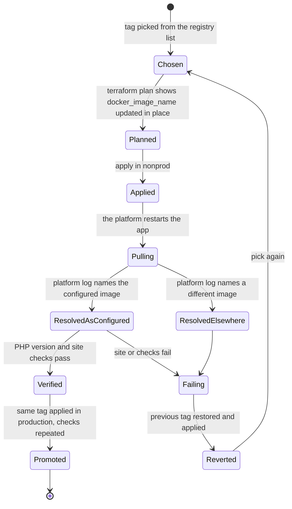

# Image-tag policy

## When to use

You are choosing the container image tag for a site, changing it, or checking which image a site really runs. The
module runs Microsoft's `mcr.microsoft.com/appsvc/wordpress-debian-php` image on the app and on its staging slot
(`modules/app-service/main.tf`). The tag is one input: `wordpress_version` on `modules/wordpress-site`, passed to the
app-service module as `docker_image_tag`. The name is historical.

## What the tag is, and what the registry offers

- **The tag is the PHP version, not a WordPress version** (`modules/wordpress-site/variables.tf`,
  `wordpress_version`).
- **A floating tag follows the platform.** `8.2` and `8.3` exist as floating tags. The default is `8.3`.
- **A dated tag is pinned.** The 8.4 series is published only as dated tags such as `8.4_20260922.3.tuxprod`
  (`<php>_<YYYYMMDD>.<n>.tuxprod`). `8.4` alone does not exist, so it cannot survive a restart. Through v4.0.1 the default
  was `8.4`; v4.1.0 changed it to `8.3` ([4.0 to 4.1](../upgrading/v4.0-to-v4.1.md)).
- **A dated tag turns off the platform's automatic image updates**, so patching the image becomes your job
  (the variable's own description).

List what the registry has right now; this is a public read and needs no login:

```bash
curl -sS https://mcr.microsoft.com/v2/appsvc/wordpress-debian-php/tags/list
```

Checked on 2026-10-17: the list held `8.2` and `8.3` as floating tags, no `8.4`, and dated 8.4 tags up to
`8.4_20261016.7.tuxprod`. Re-run it; the registry changes.

## The policy

| | Floating tag (`8.3`) | Dated tag (`8.4_20260922.3.tuxprod`) |
| --- | --- | --- |
| Image updates | The platform applies them | None until you change the tag |
| Reproducible | No: the image behind the tag moves | Yes |
| Your work | Verify after platform updates | Choose, test and bump the tag on a schedule |
| Available for | PHP 8.2 and 8.3 | Every series, and the only form for 8.4 |

A policy that follows from this, as guidance rather than something the module enforces:

1. **Nonprod runs the candidate**, floating or newest dated, and is where every change is proven first.
2. **Production runs a dated tag you have already run in nonprod**, or a floating tag if you accept platform updates
   without a review step.
3. **Bump a dated tag on a schedule**, because nothing else will, and record the tag in the change.
4. **A change of tag is a change of image on the app and the slot together**: both read `var.docker_image_tag`. On a
   site with a slot, the plan shows two in-place `docker_image_name` updates.

## Why you verify what runs

A configured tag and a clean plan prove only what Azure was asked for. In one nonprod deployment, a dated tag that
exists on the public registry was configured and the platform pulled an older, different image from its own internal
mirror: PHP 8.0 on Alpine, with the Kudu sidecar failing. That was an operator's observation, not something this
repository's tests reproduce, and a fix on the platform side may have landed since. It is why the steps below read the
platform's own logs.



## Prerequisites

- Diagnostic settings on the app send `AppServicePlatformLogs` and `AppServiceConsoleLogs` to the workspace. The module
  enables both (`modules/wordpress-site/main.tf`, `azurerm_monitor_diagnostic_setting.app_service`); logs arrive with a
  delay of some minutes.
- The nonprod site is healthy before you start, so a failure is yours.

## Steps

1. **Choose the tag** (above) and put it in the nonprod configuration:

   ```hcl
   wordpress_version = "8.4_20261016.7.tuxprod" # example: use a tag from the registry list
   ```

2. **Plan and read it.** It must show `docker_image_name` updated in place on the app (and on the slot, when there is
   one), and nothing else.
3. **Apply to nonprod.** The app restarts.
4. **Read the configured image back from Azure:**

   ```bash
   az webapp config show --resource-group <app-resource-group> --name <app-name> --query linuxFxVersion -o tsv
   ```

   Expect `DOCKER|mcr.microsoft.com/appsvc/wordpress-debian-php:<tag>`. For the slot add `--slot staging`.
5. **Read the image the platform pulled.** In the Log Analytics workspace (portal, Logs), after the restart:

   ```kusto
   AppServicePlatformLogs
   | where TimeGenerated > ago(2h)
   | where _ResourceId contains "<app-name>"
   | where Message has_any ("Pulling image", "Creating container with image")
   | project TimeGenerated, Message
   | order by TimeGenerated desc
   ```

   If the table is missing or empty, the diagnostic setting may be writing to the legacy table instead. Run the same
   filter against `AzureDiagnostics` (`where Category == "AppServicePlatformLogs"`) and read the message column there.
   Microsoft lists `AppServicePlatformLogs` as the log table for this category, and the module's own 5xx-rate alert reads
   `AppServiceHTTPLogs`, but the destination mode of a given workspace was not checked here.

   The messages must name `appsvc/wordpress-debian-php` with your tag. A different repository or an older tag is the
   failure above. The query shape comes from the log categories the module enables; the exact message text can differ
   by platform version.
6. **Check PHP inside the container:**

   ```bash
   az webapp ssh --resource-group <app-resource-group> --name <app-name>
   php -v
   ```

   The version must match the tag's series. Then fetch the site and the health-check file:

   ```bash
   curl -sS -o /dev/null -w '%{http_code}\n' https://<custom-domain>/wp-includes/images/blank.gif
   ```

   Expect `200`. If SSH or Kudu does not work after an image change, treat the image as wrong.
7. **Soak in nonprod**, then repeat steps 1 to 6 in production with the same tag. Production is a reviewed change; read
   its plan first.

## Verify

- `linuxFxVersion` shows the tag you set, on the app and on the slot.
- The platform log shows the same image, and `php -v` shows the expected series.
- A re-plan reports no changes.

## Rollback

Set the previous tag and apply; the app restarts on it. Repeat steps 4 to 6, because the platform decides what it pulls.
A floating tag has no previous value to return to: pin the last dated tag you ran instead. The tag selects the container
image only and backs nothing up, so take a [backup](backup-and-restore.md) first when the change is risky (a new PHP
series, for example).

## Sources

`modules/app-service/variables.tf` (`docker_image_tag`), `modules/app-service/main.tf`, `modules/wordpress-site/variables.tf`
(`wordpress_version`), [4.0 to 4.1](../upgrading/v4.0-to-v4.1.md), the registry's tag list.
