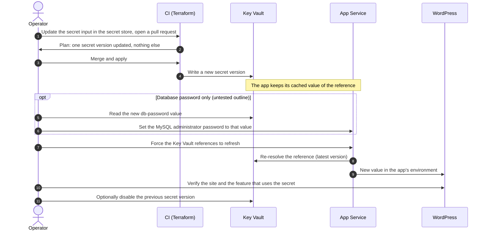

# Rotate secrets

## When to use

A secret was exposed or is due for rotation. This runbook covers every secret the module generates or uses, and says
plainly which ones have a procedure that was exercised and which do not.

| Secret | Where it lives | Rotation | Section |
| --- | --- | --- | --- |
| Values you pass in `extra_secrets` (an SMTP password, for example) | Key Vault secret, read by the app through a Key Vault reference | Change the input, apply, refresh the reference | [Key Vault secrets](#key-vault-secrets-you-supply) |
| `db-password`, the MySQL administrator password | State, the server, and the `db-password` Key Vault secret | **No exercised procedure.** An untested outline follows | [Database password](#database-password-untested) |
| `storage-key`, the storage account key | State and the `storage-key` Key Vault secret (when `storage_key_secret_enabled` is true) | Renew the key, then apply | [Storage account key](#storage-account-key) |
| The backup container SAS | App Service backup configuration and state | Automatic: re-issued by the first plan after `sas_rotation_days` | [Backup SAS](#backup-sas) |
| `cdn_origin_header_values` | State, the app's access restrictions, the CDN edge rule | Accept old and new together, switch the edge, drop the old value | [Origin-header values](#origin-header-values) |
| Cloudflare API tokens | CI secrets | Create, replace, verify, revoke | [Cloudflare API tokens](#cloudflare-api-tokens) |
| `appinsights-connection` | Key Vault secret | The module has no rotation procedure for it | |

The pipeline signs in to Azure with OIDC ([deployment guide](../deployment-guide.md)), so there is no Azure secret to
rotate. The Cloudflare token row applies only with `cdn_provider = "cloudflare"` and `cloudflare.enabled = true`.

## Prerequisites

- A working plan and apply pipeline for the environment, and a nonprod environment to rehearse in.
- Network reach to the Key Vault data plane for every command below that reads or writes a secret. The vault denies
  public access by default: your address, or the runner's, must be in `key_vault_network_acls_ip_rules`, or the
  vault must allow it otherwise ([Troubleshooting](troubleshooting.md#key-vault-403-from-ci)). Reading a secret also
  needs an access policy for your identity on the vault; the module grants one to the deploying identity and to the
  app identities only.
- Anyone who can read the Terraform state can read every module-generated secret. Rotating one does not remove the old
  value from older state file versions, so restrict old versions as you restrict current state.

## Sequence



Without the forced refresh, App Service re-resolves an unversioned reference at most every 24 hours. Any
configuration change to the app also restarts it and refetches at once
([Microsoft Learn](https://learn.microsoft.com/en-us/azure/app-service/app-service-key-vault-references)).

## Key Vault secrets you supply

For values passed through `extra_secrets` and surfaced with `extra_secret_app_settings`
([README, Custom Secrets](../../README.md#custom-secrets)). The module builds an unversioned
`@Microsoft.KeyVault(SecretUri=...)` reference, so a new secret version is picked up without changing the app's
configuration.

1. **Prepare.** Put the new value in the secret store that feeds the input (for example a CI secret mapped to a
   `TF_VAR_` variable). Do not put it in a file in the repository.
2. **Plan and apply** through the pipeline, nonprod first. The plan must show the one `azurerm_key_vault_secret`
   updated in place and nothing else.
3. **Refresh the reference.** The app's resource ID is the `app_service_id` output of the module:

   ```bash
   az rest --method post \
     --url "https://management.azure.com<app_service_id>/config/configreferences/appsettings/refresh?api-version=2022-03-01"
   ```

   This is the call Microsoft documents for forcing resolution. A restart alone is not documented to refetch; a
   configuration change is. For the staging slot, the same call against the slot's resource ID is not verified here;
   if you rely on the slot, confirm it in the portal (Application settings, edit the setting: the dialog shows the
   resolution status) or wait for the 24-hour refetch.
4. **Check the new version is the latest and the setting resolves:**

   ```bash
   az keyvault secret list-versions --vault-name <vault-name> --name <secret-name> \
     --query "[].{id:id, enabled:attributes.enabled, created:attributes.created}" -o table
   ```

   Then exercise the feature that uses it (send a test mail, for an SMTP password). The portal's Application settings
   page shows a failed reference with an error.
5. **Retire the old version** if the old value was exposed. Use the `id` of the old version from the previous command
   (a full secret URI; `--id` takes it on its own):

   ```bash
   az keyvault secret set-attributes --id <old-secret-version-id> --enabled false
   ```

   Disabling an old version does not change what Terraform tracks. Revoke the old value at its source as well (the
   mail provider, for an SMTP password).

**Rollback.** Put the old value back in the input and apply; that writes it as a newer version. Then refresh the
reference again.

## Database password (untested)

**There is no exercised procedure for this.** [The security model](../security-model.md#secret-rotation) records the
same: the MySQL server ignores changes to `administrator_password` (`lifecycle.ignore_changes` in
`modules/database/main.tf`), while `db-password` is written from `random_password.db`
(`modules/wordpress-site/main.tf`). Replacing `random_password.db` therefore changes the secret and not the server,
and WordPress cannot connect as soon as the app re-resolves the reference. Do not do that alone.

The outline below follows from that code. **It has not been run.** Rehearse it in nonprod with a restore point first,
and expect a short outage between steps 3 and 5.

1. **Take an on-demand backup and note the time** ([Backup and restore](backup-and-restore.md)):

   ```bash
   az mysql flexible-server backup create --resource-group <resource-group> --name <server-name> --backup-name pre-rotation-<date>
   ```

2. **Generate a new value in state only.** Run a job as the environment's CI identity, never as yourself (a plan under
   another identity replaces the Terraform access policy, see
   [Troubleshooting](troubleshooting.md#a-plan-wants-to-replace-the-terraform-access-policy)):

   ```bash
   terraform plan -input=false -lock-timeout=10m -replace='module.<module-name>.random_password.db'
   ```

   The plan must show `random_password.db` replaced and the `db-password` secret updated, and nothing else. A
   `-target` is not needed. Apply the same command with `terraform apply` when the plan matches. In a `for_each`
   the address is `module.<module-name>["<site>"].random_password.db`.
3. **Read the new value and set it on the server at once.** Run this on a trusted host: the value is visible in the
   process list while the command runs.

   ```bash
   NEW_DB_PASSWORD="$(az keyvault secret show --vault-name <vault-name> --name db-password --query value -o tsv)"
   az mysql flexible-server update --resource-group <resource-group> --name <server-name> --admin-password "$NEW_DB_PASSWORD"
   unset NEW_DB_PASSWORD
   ```

4. **Force the app to re-resolve the reference** (the `az rest` call above) and check the site.
5. **Check the database login** with a page that reads the database, and confirm a re-plan reports no changes.

If the site cannot connect afterwards, the server and the secret disagree. The repair is step 3 again (set the server
to the secret's current value): Terraform state now holds the new value, so going back to the old one is more work, not
less. The staging slot keeps `DATABASE_PASSWORD` even after the production app drops it
([deployment guide step 13](../deployment-guide.md#step-13-turn-on-the-v430-opt-ins-one-at-a-time)); refresh it too.

The WordPress administrator password is separate: the `WORDPRESS_ADMIN_*` settings only create the first user, so
change that password inside WordPress after you sign in ([Getting started](../getting-started.md#the-administrator-account)).

## Storage account key

`storage-key` holds the account's **primary** key (`module.storage.primary_access_key` in
`modules/wordpress-site/main.tf`). The backup SAS is signed from the same key.

1. **Know the cost.** Between the renewal and the next apply, the scheduled backup fails (its SAS no longer
   validates) and so does any Blob offload plugin that uses the key. Run the apply straight after.
2. **Renew the primary key:**

   ```bash
   az storage account keys renew --resource-group <resource-group> --account-name <storage-account> --key primary
   ```

3. **Apply immediately.** The plan shows the web app's backup block updated in place with a new SAS, and, only when
   `storage_key_secret_enabled` is true, the `storage-key` secret updated too (the module writes no such secret when it is false).
   Do not wait for the secret line: the backup needs the apply either way ([README, The SAS](../../modules/wordpress-site/README.md#the-sas-source-rotation-and-trade-off)).
4. **Refresh the reference** if a plugin uses `MICROSOFT_AZURE_ACCOUNT_KEY` (the `az rest` call above).
5. **Check the backup**: list the backups and confirm a new one finishes after the apply.

   ```bash
   az webapp config backup list --resource-group <app-resource-group> --webapp-name <app-name> -o json
   ```

   Read the newest entry's status in the output. The field names were not checked against a live backup here.

**Rollback.** There is none for a renewed key: the old key no longer exists. The apply is the recovery.

## Backup SAS

Nothing to do by hand. The first plan after `sas_rotation_days` (default 180) replaces the three `time` resources and
updates the web app's backup block. Apply it before `sas_validity_days` (default 365) from the rotation date elapses, or
the backup stops. Schedule a plan-only run and read the dates from the module outputs
`app_service_backup_sas_rotation_rfc3339` and `app_service_backup_sas_expiry_rfc3339`
([deployment guide Verify item 7](../deployment-guide.md#verify)).

## Origin-header values

Applies when `app_service.cdn_origin_header_name` is set. The list `cdn_origin_header_values` holds 1 to 8 values, so
old and new can be accepted together
(`modules/wordpress-site/variables.tf`, `modules/app-service/variables.tf`).

1. Generate a new UUID in a secret store (for `x_azure_fdid` the values must be UUIDs).
2. Add it to `cdn_origin_header_values` **next to** the current one and apply. The origin now accepts both.
3. Change the edge's Request Header Transform Rule to send the new value, in your Cloudflare configuration.
4. Check the public site: `curl -sS -o /dev/null -w '%{http_code}\n' https://<custom-domain>/` prints `200`. The origin
   itself answers `403` to anything not coming from the CDN, so do not test it directly.
5. Remove the old value from the list and apply.

**Rollback.** Before step 5, switch the edge back to the old value. After step 5, add the old value again, apply, then
switch the edge. To roll back the whole filter, remove the origin filter before the edge rule
([README, Binding Cloudflare rules to your zone](../../modules/wordpress-site/README.md#binding-cloudflare-rules-to-your-zone)).

## Cloudflare API tokens

Applies with `cdn_provider = "cloudflare"` and `cloudflare.enabled = true`. The provider reads `CLOUDFLARE_API_TOKEN`
from the job's environment; do not pass it as a Terraform variable
([deployment guide step 4](../deployment-guide.md#step-4-lay-out-one-root-configuration-per-environment)). Plans need a
token as well as applies, because the module looks the zone up on every plan.

1. **Create the replacement** in Cloudflare with the same permissions and the same zone scope as the old token
   ([deployment guide step 5](../deployment-guide.md#step-5-write-the-pipeline) lists the permissions). Use a separate,
   read-only token for pull-request plans and a write token for applies.
2. **Store it** without echoing it. `gh secret set` reads the value from standard input when `--body` is omitted:

   ```bash
   gh secret set CLOUDFLARE_API_TOKEN --env <environment> --repo <owner>/<repo>
   gh secret set CLOUDFLARE_API_TOKEN_READ --repo <owner>/<repo>
   ```

   Never store a write token as a repository or organization secret.
3. **Prove it.** Run a plan, and for the write token an apply that changes nothing, as the pipeline does. A failure
   names the missing permission.
4. **Revoke the old token** in Cloudflare only after step 3 passed.

**Rollback.** Until you revoke the old token, put it back in the secret and re-run. After revocation, create a
new one.

## Verify

- The site serves, and the feature that used the secret works.
- A re-plan as the CI identity reports no changes.
- The old secret value is revoked at its source where you can revoke it (mail provider, Cloudflare), or disabled in
  Key Vault.

## Sources

`modules/wordpress-site/main.tf` (`random_password.db`, `module_secrets`), `modules/database/main.tf`
(`ignore_changes`), `modules/wordpress-site/backup.tf`, `modules/wordpress-site/variables.tf`,
[security model](../security-model.md), [deployment guide](../deployment-guide.md).
