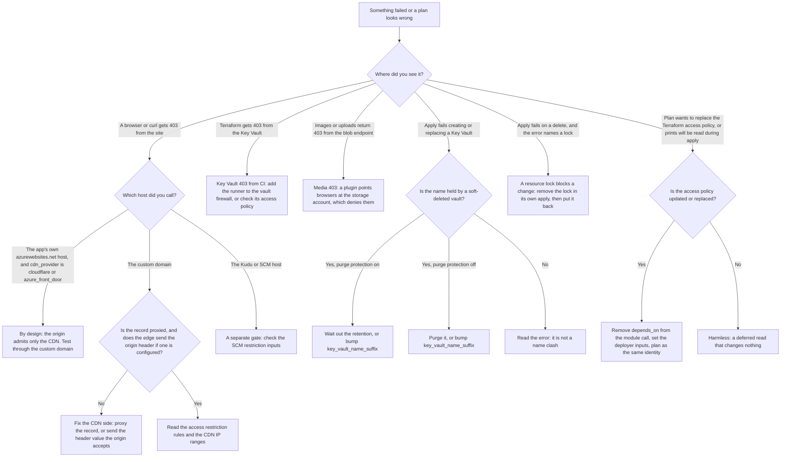

# Troubleshooting

## When to use

A request returns `403`, an apply fails on Key Vault, storage or a lock, or a plan wants to replace something it should
not. Each section is one symptom: cause, how to confirm it, the fix, and how to back out. Start with the flowchart.



## A 403 at the origin is by design

**Cause.** With `cdn_provider = "cloudflare"` the app (and its staging slot) allow only Cloudflare's published address
ranges and the Azure health-probe address, and deny the rest. With `azure_front_door` they allow the Front Door service
tag and, on the main app, pin it to your profile with an `X-Azure-FDID` header. These rules belong to the site, so they
also govern the default `*.azurewebsites.net` host. With the default `cdn_provider = "direct"` nothing is restricted.
Sources: `modules/app-service/main.tf` (`ip_restriction`), [security model](../security-model.md#origin-restricted-to-the-cdn).

**Confirm.**

```bash
az webapp config access-restriction show --resource-group <resource-group> --name <app-name> -o json
curl -sS -o /dev/null -w '%{http_code}\n' https://<custom-domain>/
curl -sS -o /dev/null -w '%{http_code}\n' https://<app-name>.azurewebsites.net/
```

Behind a CDN you expect `200` from the custom domain and `403` from the app's own host. The second is the design, not a
fault.

**It is a fault when the custom domain also returns 403.** Check, in this order:

1. **The DNS record is not proxied** (`cloudflare.proxied = false`): your request reaches the origin from your own
   address, which the origin denies. The availability test fails for the same reason.
2. **The origin-header filter is on** (`app_service.cdn_origin_header_name` set) and the edge does not send an accepted
   value ([Rotate secrets](rotate-secrets.md#origin-header-values)). Enable the edge rule before the origin filter.
3. **Cloudflare's address ranges changed.** The ranges are read on every run, so the next plan shows an update; apply it.
4. **Front Door:** the custom domain is not validated yet, or the main app's restriction list was reset. After an apply
   the web app can restore the module's list without the FDID check, and the next plan patches it back
   ([deployment guide Verify item 1](../deployment-guide.md#verify)).

**Do not** switch to `direct` or add an allow rule to "fix" a 403 from the app's own host. To reach the container for
debugging, use the SSH console, which goes through the SCM site (`az webapp ssh --resource-group <resource-group> --name <app-name>`).
SCM is a separate gate with its own rules (`app_service_scm_ip_restrictions`), open by default.

**Rollback.** Nothing changed unless you edited rules; revert that change.

## Key Vault 403 from CI

**Cause.** The vault's firewall denies by default, and Terraform is not a trusted Azure service. The apply writes the
module's secrets (`db-password`, `storage-key`, `appinsights-connection`, and your `extra_secrets`), and the vault returns
`403` unless the runner is allowed. The site's own app subnet is allowed automatically, so Key Vault references keep
working. A second cause is the identity: the vault uses access policies, and only the deploying identity and the app
identities get secret access, so a different planning identity fails on refresh
(`modules/key-vault/main.tf`, [deployment guide step 6](../deployment-guide.md#step-6-decide-whether-to-set-the-deployer-id-inputs)).

**Confirm.** Which of the two is it:

```bash
az keyvault show --name <vault-name> --query "properties.networkAcls" -o json
az keyvault show --name <vault-name> --query "properties.accessPolicies[].objectId" -o tsv
```

Read the first for `defaultAction` and whether the runner's egress address is listed under `ipRules` or its subnet under
`virtualNetworkRules`. Read the second for the identity that runs Terraform. Your own access to the data plane is subject
to the same firewall.

**Fix**, in the configuration, never on the vault by hand:

1. A runner with a stable egress address: `key_vault_network_acls_ip_rules = ["<runner-egress-ip>"]`.
2. A runner in a subnet that carries the `Microsoft.KeyVault` service endpoint:
   `key_vault_network_acls_virtual_network_subnet_ids`.
3. Hosted runners with no fixed address: `key_vault_public_network_access_enabled = true`. This opens the vault's data
   plane to the internet and relies on authentication alone; decide it deliberately.

For an identity mismatch, plan and apply as the same identity, or set `deployer_object_id` and `deployer_tenant_id`.

A rule added with `az keyvault network-rule add` is outside Terraform, so the next apply plans its removal; it is a
diagnostic step at most.

**Rollback.** Revert the input. Tightening the firewall again does not affect the secrets.

## A media 403 when storage denies access

**Cause.** By default media stays on the app's `/home` storage and no browser reads the storage account. A `403` on
`<account>.blob.core.windows.net` appears only when you installed a Blob offload plugin that rewrites media URLs to the
account. Two gates then apply to a browser: the firewall (`storage_network_rules_default_action = "Deny"` refuses it) and
anonymous access (the account sets `allow_nested_items_to_be_public = false` and the uploads container is private, and
neither is an input). Source: `modules/storage/main.tf`, [architecture, Media](../architecture.md#media).

**Confirm.**

```bash
az storage account show --name <storage-account> --query "{firewall:networkRuleSet.defaultAction, anonymous:allowBlobPublicAccess}" -o json
```

Expect `Deny` and a false (or null) anonymous setting. Then find the failing URL in the browser's network tab: a host
ending in `.blob.core.windows.net` means the plugin, not WordPress, is serving it.

**Fix.** Setting `storage_network_rules_default_action = "Allow"` removes only the first gate. It is **not** enough on its
own: Azure still rejects anonymous reads, and the Microsoft Azure Storage for WordPress plugin writes unsigned URLs. The
sound fixes are to serve media from `/home` (turn the plugin's default-upload option off), or to use a plugin and a
CDN origin design that authenticate to the account. Whether another plugin signs its URLs is **unknown**; check it in
nonprod. The backup and the app's own writes are unaffected by `Deny` because the app subnet is allow-listed.

**A restore under `Deny`** that fails to reach the account is the same gate from another side: a new app needs its own
route, by subnet rule, IP rule or `"Allow"` for the duration of the restore
([Backup and restore](backup-and-restore.md#3-app-service-custom-backup)).

**Rollback.** Revert the input; nothing else changed.

## A soft-deleted vault still holds its name

**Cause.** Deleting a Key Vault soft-deletes it, and the name stays reserved for the retention period (7 to 90 days).
With purge protection on, it cannot be purged early by anyone, including a subscription Owner. The azurerm provider's
`recover_soft_deleted_key_vaults` defaults to `true`, so a create under the same name **recovers the old vault** instead
of making a new one. If that old vault has purge protection on and the new configuration turns it off, Azure refuses.
Recovery also restores the vault in its original region, so reusing a name while changing `location` strands the vault
there. Sources: [Key Vault README](../../modules/key-vault/README.md), [2 to 3](../upgrading/v2-to-v3.md).

**Confirm.**

```bash
az keyvault list-deleted --subscription <subscription-id> -o json
```

Find your vault by `name`; read its purge-protection flag and scheduled purge date in the output. The field names were
not checked against a live listing.

**Fix.** Do the first that applies:

1. **Bump `key_vault_name_suffix` in the same change** as whatever replaces the vault, and always when you change
   region. The vault name is `kv-<site>-<env><suffix>`; the whole name must stay within 24 characters. This works with
   purge protection on or off.
2. **Purge protection off:** the provider purges on destroy by default, which frees the name at once. A vault deleted by
   other means can be purged by hand:

   ```bash
   az keyvault purge --name <vault-name> --location <location>
   ```

3. **You actually want the old vault back:** `az keyvault recover --name <vault-name> --resource-group <resource-group>
   --location <location>`, then import it into state before the next apply.

**Rollback.** Bumping the suffix creates a new vault; the old one stays soft-deleted until its retention ends. The module
writes every secret into the new vault again, so nothing is lost, but the app's references move to the new URIs on that
apply.

## A resource lock blocks a change

**Cause.** `lock = { kind = "CanNotDelete" }` (or `enable_resource_lock`) on the site, and `lock` on the shared
infrastructure, make Azure refuse every DELETE in the group, including diagnostic settings and alert rules. Any removal,
any replacement (Key Vault, MySQL server, a diagnostic setting's name or target), and turning an alert family off fails
at apply with an error that names the lock. Source: [README, Resource locks](../../modules/wordpress-site/README.md#resource-locks).

**Confirm.**

```bash
az lock list --resource-group <resource-group> -o table
```

For a site on a shared plan, also list the shared group. You need `Microsoft.Authorization/locks/*` to change a lock:
Owner or User Access Administrator, not Contributor.

**Fix.** Do it in three separate applies so the order is certain:

1. Set `lock = null` (or `enable_resource_lock = false`) and apply.
2. Make the change that needed the delete, and apply.
3. Restore the lock and apply.

Remove the lock through the configuration. Deleting it with `az lock delete --name <lock-name> --resource-group <resource-group>`
works, but Terraform then plans to recreate it in the very apply you run next, and the lock can come back before your change.

**Rollback.** Put the lock back. While it is off on a shared group, the other sites there are unprotected: keep the window
short.

## A plan wants to replace the Terraform access policy

**Cause.** A data source inside a module called with `depends_on` is read at apply time whenever any `depends_on` target
has a pending change, even a sibling site's. Through v4.0.1 the Key Vault module read the deploying identity that way, so
an unrelated change made the plan replace `azurerm_key_vault_access_policy.terraform` on every site. The apply then
fails with "already exists", and a retry plans the replacement again. Since v4.0.2 the composition reads the identity in a
scope without `depends_on` and passes it in. Two things still cause it: a `depends_on` on your call to `wordpress-site`,
and a planning identity that differs from the applying one. Sources: `modules/wordpress-site/main.tf`,
[4.0 to 4.1](../upgrading/v4.0-to-v4.1.md), [deployment guide steps 6 and 7](../deployment-guide.md#step-6-decide-whether-to-set-the-deployer-id-inputs).

**Confirm.** Plan and look for the policy and the deferred lines:

```bash
terraform plan -input=false -lock-timeout=10m -no-color > plan.txt
grep -n -E "azurerm_key_vault_access_policy|will be read during apply|forces replacement" plan.txt
```

Delete `plan.txt` afterwards. Read what the policy line says:

- **Updated or replaced:** the real problem. Do not apply it.
- **Only "will be read during apply"** for `module.key_vault.data.azurerm_client_config.current`, with no policy change:
  harmless. The same is true of the backup SAS data source on a first plan or while the SAS rotates.

**Fix.**

1. Remove any `depends_on` from the `wordpress-site` module call; pass a value in an input instead.
2. Plan and apply as one identity per environment, or set `deployer_object_id` and `deployer_tenant_id` (both, lower-case
   object ID).
3. Plan again; the policy must not change and its `object_id` must be known.

If an apply already failed with "already exists", import the existing policy so the next plan matches reality. The ID is
the vault's resource ID plus `/objectId/<object-id>`, from the provider's documentation:

```bash
terraform import 'module.<name>.module.key_vault.azurerm_key_vault_access_policy.terraform' \
  '/subscriptions/<subscription-id>/resourceGroups/<resource-group>/providers/Microsoft.KeyVault/vaults/<vault-name>/objectId/<object-id>'
```

Quote the address in a `for_each` (`module.<name>["<site>"]...`). Run it as the environment's CI identity.

**Rollback.** None needed: a plan changes nothing. If you applied a plan that deleted the pipeline's policy, the next
refresh fails with `403`; restore the policy by importing it (above) or by re-applying as an identity with access.

## Verify

For each fix: re-run the action that failed, then a plan that reports no changes. For a 403, test from where the
request originates, not from where it is easy.

## Sources

`modules/app-service/main.tf`, `modules/key-vault/main.tf`, `modules/storage/main.tf`, `modules/wordpress-site/main.tf`,
[security model](../security-model.md), [architecture](../architecture.md), [deployment guide](../deployment-guide.md),
the provider documentation for `azurerm_key_vault_access_policy`.
