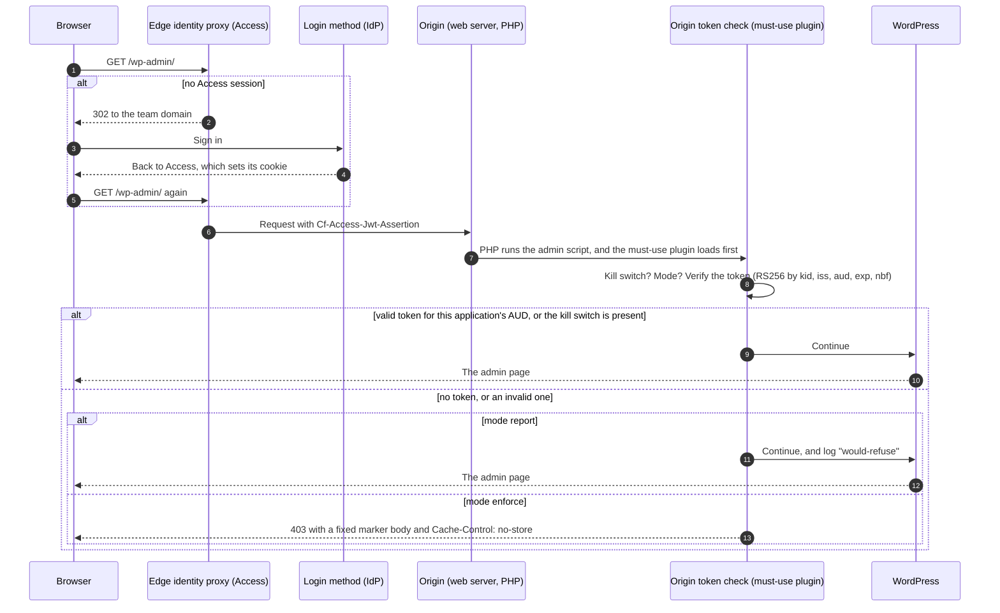
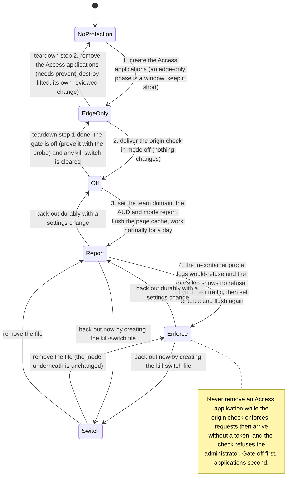

# Pattern: protecting wp-admin with an edge identity proxy and an origin token check

The module restricts the origin to the CDN and nothing more: `/wp-admin` and `/wp-login.php` are protected only by
WordPress's own login ([Security model, Protecting `/wp-admin`](../security-model.md#protecting-wp-admin)). This page
describes a two-layer pattern that one consumer of the module rolled out with `cdn_provider = "cloudflare"`: an
identity-aware proxy at the edge, as Cloudflare Access applications on the admin paths, and an origin-side check of the
proxy's signed token, rolled out `off`, then `report`, then `enforce`. It is written to be reused: every name below is a
placeholder, every Cloudflare claim is cited to Cloudflare's documentation, and every measured claim carries its date.
The module itself is unchanged by this pattern; it needs no module release and no new input.

Where this page says "measured", the measurement is the consumer's, on its own non-production and production sites,
on the dates given. Where it says UNKNOWN, nobody has measured it.

## Why two layers

An edge-only control has routes around it, and this module's defaults leave some of them open:

- **The direct-origin route.** By default the module admits the CDN's network, not your account: with Cloudflare, the
  origin's IP restrictions allow Cloudflare's published ranges, so a request from another Cloudflare account's Worker
  reaches the origin without passing your Access applications. The module can close that with
  `app_service.cdn_origin_header_name` and `cdn_origin_header_values`, which make the Cloudflare rules also require a
  header value only your zone adds ([Security model, Binding the origin to one CDN
  account](../security-model.md#binding-the-origin-to-one-cdn-account)); the consumer had not set it at the time.
- **Paths the proxy does not match.** Access matches an application by domain and path
  ([Application paths](https://developers.cloudflare.com/cloudflare-one/access-controls/policies/app-paths/)). The origin
  decodes and resolves the URL for itself: measured 2026-10-04 and 2026-10-05 on two hosts, Access matched mixed-case
  forms such as `/WP-LOGIN.php`, but not `%2F` forms such as `/wp-admin%2Findex.php`, nor traversal forms such as
  `/wp-admin/admin-ajax.php/..%2F..%2Fwp-login.php`, all of which the origin served as the real login or admin code.

So the rule of the pattern is: **never enable the edge application without the origin check.** The origin check
decides on the PHP that executes, which is the same whatever the URL looked like, and in `enforce` it refuses a
request for `wp-login.php` or a `wp-admin` script that loads WordPress (`admin-ajax.php` excepted) when the request
did not come through your Access application, whatever route it took. It protects nothing else: `/wp-json/`,
`/wp-cron.php`, the public site and cookie-authenticated requests to the exempt path stay as WordPress leaves them.
Cloudflare
says the same about its own tokens: "Token validation ensures that any requests which bypass Cloudflare Access (for
example, due to a network misconfiguration) are rejected"
([Publish a self-hosted application](https://developers.cloudflare.com/cloudflare-one/access-controls/applications/http-apps/self-hosted-public-app/)).
What a must-use plugin cannot reach is listed under [What this pattern does not cover](#what-this-pattern-does-not-cover).



## The edge applications

One self-hosted Access application per host, plus one bypass application. With the Cloudflare Terraform provider v5
the resources are `cloudflare_zero_trust_access_application` (type `self_hosted`, `destinations` of type `public`) and
`cloudflare_zero_trust_access_policy`; the consumer checked the arguments against provider v5.25.0's documentation.

| Application | Destinations | Policy | Why |
| --- | --- | --- | --- |
| `wp-admin-<env>` | `<host>/wp-admin` and `<host>/wp-login.php` | Allow, for the named administrators | One application, so each host has one Application Audience (AUD) tag and one application token. `/wp-admin` is written without a wildcard: "Using a wildcard in the Path field does not cover the parent path", so `/wp-admin/*` would leave `/wp-admin` itself open. Query strings "are not supported in Access application paths", so every `wp-login.php?action=…` shares one decision ([Application paths](https://developers.cloudflare.com/cloudflare-one/access-controls/policies/app-paths/)). |
| `wp-admin-ajax-bypass-<env>` | `<host>/wp-admin/admin-ajax.php` | Bypass, Everyone | "When multiple rules are set for a common root path, the more specific rule takes precedence … and no rule is inherited" from the broader one ([Application paths](https://developers.cloudflare.com/cloudflare-one/access-controls/policies/app-paths/)), so this application wins for that one path. Bypass "disables any Access enforcement for traffic that meets the defined rule criteria", and Cloudflare's own example of it is "an endpoint under the /admin route that must be publicly routable" ([Access policies](https://developers.cloudflare.com/cloudflare-one/access-controls/policies/)). See [The admin-ajax.php bypass](#the-admin-ajaxphp-bypass). |

Points worth getting right the first time:

- **Bind each administrator to a login method with a separate policy** (this one was a review finding for the
  consumer: its first draft put both addresses in one policy). Access evaluates sibling Include rules as OR and
  Require rules as AND ([Access policies](https://developers.cloudflare.com/cloudflare-one/access-controls/policies/)),
  so one policy that Includes two addresses lets either address sign in with either enabled method. Two Allow
  policies, each Including one address and Requiring one `login_method`, keep the primary identity on the provider
  whose MFA you rely on and the fallback address on the one-time PIN.
- **Two login methods, on different providers.** The fallback mailbox for the one-time PIN should not be hosted by
  the primary identity provider, so one outage cannot take both.
- **Session.** An application session of one working day (the consumer chose 12 hours); the global session stays at
  its default. When the application token expires, "Cloudflare will automatically issue a new application token if the
  global token is still valid"
  ([Session management](https://developers.cloudflare.com/cloudflare-one/access-controls/access-settings/session-management/)).
- **`prevent_destroy` on both applications.** "The AUD tag will never change unless you delete or recreate the Access
  application" ([Validate JWTs](https://developers.cloudflare.com/cloudflare-one/access-controls/applications/http-apps/authorization-cookie/validating-json/)).
  Recreating one changes the AUD, and an enforcing origin check then refuses the administrator until the origin's
  settings follow. The cost is that removing a host becomes its own reviewed change (see
  [Rollout and rollback order](#rollout-and-rollback-order)).
- **Keep the Access resources in their own Terraform root** with an account-scoped token limited to Access
  applications and policies, separate from the zone's token: Access is account-level, and a mistake here locks the
  administrator out, so it should be reviewable and revertible on its own. The Zero Trust organisation and the
  identity providers can stay manual; their IDs are plain variables.
- **A `www` redirect needs no application of its own.** A Single Redirect runs in the `http_request_dynamic_redirect`
  phase, which Cloudflare lists before the Access application check
  ([Phases list](https://developers.cloudflare.com/ruleset-engine/reference/phases-list/)), so the apex's
  applications see the redirected request.

## The origin token check

A must-use plugin, loaded by WordPress before any ordinary plugin and before `wp-login.php` reads a posted password,
installed on every app of the environment. Its contract, with the reasons:

- **It acts on the PHP being executed, never on the URL.** It resolves the script path the web server set (on this
  image, `SCRIPT_FILENAME`), lower-cases it once, and tests that one string: login when it ends in `/wp-login.php`;
  admin when it is under the resolved `wp-admin` directory; exempt when it is exactly `wp-admin/admin-ajax.php`, or
  when WP-CLI is running (a constant only the CLI runtime defines, never a web request). Keying on the directory, not
  on WordPress's `WP_ADMIN` constant, matters because the maintenance endpoints `install.php`, `upgrade.php`,
  `setup-config.php` and `maint/repair.php` do not define it. Keying on the resolved script, not the URL, is what
  closes the traversal form: `/wp-admin/admin-ajax.php/..%2F..%2Fwp-login.php` carries the exempt path in its URL but
  executes `wp-login.php`.
- **It checks the `Cf-Access-Jwt-Assertion` header, not the `CF_Authorization` cookie.** Cloudflare recommends "validating
  the `Cf-Access-Jwt-Assertion` header instead of the `CF_Authorization` cookie, since the cookie is not guaranteed to
  be passed" ([Validate JWTs](https://developers.cloudflare.com/cloudflare-one/access-controls/applications/http-apps/authorization-cookie/validating-json/)).
- **The algorithm is fixed to RS256 and never read from the token.** The key is chosen by `kid` from
  `https://<team>.cloudflareaccess.com/cdn-cgi/access/certs`, which "contains two public keys: the current key used to
  sign all new tokens, and the previous key that has been rotated out", as JWKs in `keys` and as PEM in
  `public_certs` (same source). Then the signature, `iss` (the team domain) and `aud` are checked ("The `aud` claim in
  the token payload specifies which application the JWT is valid for", same source), and `exp` and `nbf`, which the
  token carries ([Application token](https://developers.cloudflare.com/cloudflare-one/access-controls/applications/http-apps/authorization-cookie/application-token/)),
  with a small leeway of the consumer's choosing.
- **Keys are cached on persistent storage and refreshed on a schedule.** "Access rotates the signing key every 6 weeks
  … Previous keys remain valid for 7 days after rotation" (Validate JWTs), so a daily refresh is the baseline, and no
  cached set is trusted for longer than 7 days after its fetch: past that, every token is refused until a refresh
  succeeds. It fails closed; the kill switch is the way in meanwhile. The consumer's schedule is a daily WP-Cron
  event; WP-Cron runs only when something requests the site, so a low-traffic admin host needs an external call to
  `wp-cron.php`. Recovery from a stale set (`reason=keys-stale`): from inside the container confirm that the certs
  endpoint answers 200, run the refresh by hand **as the web server's user, never as root** (the consumer's plugin
  writes nothing as root, because a link planted in the web user's state directory would let root write through it,
  and logs that it did not refresh), confirm the cache file's modification time moved, then clear the kill switch.
- **A refresh on an unknown `kid` is single-flight and rate-limited across PHP-FPM workers.** On the direct-origin
  route an attacker can send a syntactically valid token with a new `kid` on every request; an unbounded refresh would
  turn each into a blocking outbound HTTPS call before the 403. The consumer uses an exclusive, non-blocking lock on a
  file beside the key cache, covering the read of the last attempt's time, the fetch and the record of the attempt as
  one step, with at most one attempt per five minutes; while the last attempt is fresh, an unknown `kid` is refused
  against the cached set with no outbound call. A per-process flag is not enough: PHP-FPM runs several children.
- **Configuration is three app settings, none secret:** the mode, the team domain and the AUD (the AUD is in every
  token's `aud` claim). On this module they go in `app_service.extra_app_settings`, which the app-service module
  merges after its own settings on the production app and on the staging slot alike (`extra_secret_app_settings` wins
  on a name collision). Because the slot receives the same three settings, a slot that carries the plugin file enforces
  too, with no Access application in front of it: see [the slot](#what-this-pattern-does-not-cover). Never name a
  setting with an `HTTP_` prefix: request headers arrive as `HTTP_*` FastCGI parameters, which `getenv()` also reads.
- **Modes:** `off` (unset, empty or `off`: nothing runs, no hooks, no files, no outbound call), `report` (validate and
  log what would be refused, never refuse) and `enforce` (refuse with 403, a fixed marker body and
  `Cache-Control: no-store`). Any other value enforces, so a typo fails closed, and `enforce` with the team domain or
  the AUD missing or malformed refuses every gated request.
- **Log lines carry a decision and a reason, never the token, a claim or a setting's value**, for example
  `mode=report decision=would-refuse reason=no-token script=<path>`. The `would-refuse` line is what the pre-enforce
  probe reads. On this image the plugin logs through `error_log()`, which the PHP-FPM pool writes under `/var/log`,
  outside `/home`: App Service keeps nothing written there across a restart, so the log covers only the time since the
  container last started. Read it before any restart.
- **The kill switch** is a file outside the web root on the persistent `/home` mount, for example
  `/home/site/access-gate.disabled`. While it exists, every gated request passes in `report` and `enforce`, and each
  logs `decision=kill-switch`; in `off` nothing runs and nothing is logged. It is outside the web root so that a restore
  of the web root from an archive neither removes it nor brings it back, and on `/home` so that every instance shares it
  and a restart keeps it. See [The kill switch](#the-kill-switch).

The consumer's implementation is about 900 lines of PHP with a CLI test suite, delivered by a workflow that installs the
file atomically, verifies its checksum, waits for the opcode cache and reads the result back. It is not published; this
page is the specification to build from (see [Publishing decision](#publishing-decision)).

## Rollout and rollback order



**Forward, non-production first.** Each step is a change you can read in a plan, and the next starts only when the
previous one's checks pass:

0. **Close the direct-origin route first, or know that it is open.** Until the plugin is installed, the origin check
   cannot help a fresh app: its installer and every admin script are reachable from another Cloudflare account's
   Worker, past your zone's WAF rules and Access alike. Set `app_service.cdn_origin_header_name` and
   `cdn_origin_header_values` so that the origin also requires a header only your zone adds
   ([Security model](../security-model.md#binding-the-origin-to-one-cdn-account)), and prove it with a request from a
   Cloudflare address that lacks the header, which must be refused, before you create an app that will hold content.
   The consumer had not set it at the time and tracked it as its own item; its sites were installed headlessly and
   the installer was never served.
1. **The Access applications** for the non-production host, from their own Terraform root. Then the edge rows of the
   [test matrix](#test-matrix): the protected paths answer with a 302 to the team domain, `admin-ajax.php` does not.
2. **The origin check, delivered in mode `off`.** Nothing changes; the same rows read the same.
3. **Settings: team domain, AUD, mode `report`.** The change restarts the container. Flush the origin page cache
   ([Cache interactions](#cache-interactions)). Work normally for at least a day: sign in with each login method, edit,
   upload an image, leave the editor open past an Access expiry, and read what the check would have refused. Every
   gated request of your own must log `decision=allow`. The log does not survive a restart (above): read it before
   any restart, and if the container restarted during the day, the day is not complete yet.
4. **Prove the check directly, then `enforce`.** Most matrix rows from a normal client stop at the edge or at the
   origin's IP restriction, so they cannot tell a working check from a missing one. The one request that reaches the
   origin without a token is made from inside the container, over the SCM SSH route:

   ```sh
   curl -sS -H 'Host: <host>' -H 'X-Forwarded-Proto: https' http://127.0.0.1/wp-login.php
   ```

   The forwarded-protocol header is what the web server sees behind the CDN; without it WordPress answers a 302 to
   HTTPS instead of the form (measured by the consumer). The sequence is: in `report`, the request serves the form and
   logs `would-refuse` (that line proves the check is present and wired); then set `enforce`, which restarts the
   container; flush the page cache again; repeat the same request, which must now answer the 403 marker; only then run
   the whole matrix.
5. **Production,** the same four steps in the same order, each a production change under your own approval rules.
   The consumer shortened production's `report` day because the site was not yet in use; a site with editors gets the
   full day.
6. **After:** a scheduled probe of the matrix's read-only rows, and a record of what was built.

**Back out.** Right now: the kill switch, which needs no deploy but does need SSH. Durably: a settings change back to
`report` or `off`, which restarts the container, and on production is a production change. Then the probe: a host whose
check is no longer enforcing must leave the probe's list of enforcing hosts, or the probe fails the row that expects
the 403.

**Teardown, in this order.** First the origin check off, proved by the in-container probe serving the login form and
logging nothing (a kill switch set earlier does not prove it: in mode `off` the check logs nothing at all), then any
kill switch cleared (left in place, it would silently disable a check turned on again later), then the Access
applications removed, in their own reviewed change because `prevent_destroy` refuses the plan until it is lifted, and
last, optionally, the plugin file deleted. Removing an application first locks the administrator out, because requests
then arrive without a token and the check refuses them.

**What the consumer measured and what it did not.** On the non-production host the consumer installed the check
`off` first (2026-09-28), then created the Access applications and set `report` (2026-10-03), then `enforce`
(2026-10-04), so steps 1 and 2 above ran in the other order there and no edge-only window existed. Production ran
the four steps in the order above on 2026-10-05, with the matrix after each switch. The kill switch's effect has not
been measured on a live site: its branch passes the plugin's CLI tests, and what was measured on the mount is only
that the PHP-FPM user can create the file. **The back-out path, kill switch and durable mode change included, has not
been rehearsed on a non-production site**, and no tested procedure exists yet for removing an application past
`prevent_destroy`: both are open items on the consumer's side. Until a rehearsal is recorded, treat the back-out steps
above as the design, not as measured.

## The kill switch

- It opens **only the origin check**, and that is safe only while an Access application still covers the host. With
  the switch set and no application, WordPress's own login is the only layer on the zone route, so never pair a set
  switch with a missing application or a broad dashboard Bypass, and keep the window short. If Access itself locks you
  out, see [Break-glass](#break-glass).
- It is set and cleared over SSH (`touch` and `rm -f` the file), so it depends on SCM access being up. Each gated
  request while it exists in `report` or `enforce` logs `decision=kill-switch`, and the in-container probe serves the
  login form.
- **A rule the consumer learned on App Service:** the switch must be no easier to set than the check is to remove. On
  this image the PHP-FPM user can create files in `/home/site`, so a compromised site could set the switch. That is
  acceptable only because the same user can also write `wp-content` and so remove or rename the must-use plugin
  itself: a switch only root could create would protect nothing the plugin's own file does not already expose. The
  consumer's installer checks both facts on every run and refuses to install where the switch would be the weaker spot.
  Measure this on your own image before relying on it.
- Clear it as soon as the cause is fixed, and never leave it in place when a check is set back to `off`: it does nothing
  there, and it would disable the next `report` or `enforce` silently.

## Cache interactions

Two caches can serve the login or admin page without the check ever running:

- **The CDN.** When the module manages the zone and `cloudflare.enable_page_rules` is left `true` (the default), its
  page rules bypass the cache on `*/wp-admin/*` and `*/wp-login.php*` (`modules/cloudflare/page-rules.tf`); on a zone
  you manage yourself, add the equivalent bypass before step 3. The module's Front Door route has caching enabled on
  every path, with the query string in the cache key, and the rule set that would disable it for `wp-admin/` and
  `wp-login.php` is not attached to the route as of v4.3.1 (`modules/front-door/main.tf`). Front Door "honors" an
  origin's `private`, `no-cache` and `no-store` directives "and doesn't cache the responses, even if you override the
  caching behavior by using the Rules Engine"
  ([Front Door caching](https://learn.microsoft.com/azure/frontdoor/front-door-caching)), and the check's refusals
  carry `Cache-Control: no-store`, so an admin page is stored only if the origin sent a cacheable response; attach the
  rule set or disable caching for those paths before relying on this pattern with Front Door. Whether Cloudflare ever
  caches an Access-protected response was not measured: UNKNOWN.
- **The origin page cache.** A page-cache plugin's drop-in (`advanced-cache.php`) answers from its store before
  WordPress includes must-use plugins, so a response it stored for a gated script is served without reaching the
  check. The consumer measured two things with W3 Total Cache (2.8.2 in a replica of the image and 2.10.6 on the site,
  in September 2026, before the check's first delivery on 2026-09-28): its reject rules read the raw, still-encoded
  request URI, so `/%77p-login.php` escapes them while the web server decodes it and runs `wp-login.php`; and its store
  lives for an hour on this image. So the check defines `DONOTCACHEPAGE` on every gated response, allowed ones
  included, and the rollout flushes the page cache when the check turns on (`off` to `report`) and again at `report`
  to `enforce`, over SSH:

  ```sh
  wp --allow-root --path=/home/site/wwwroot w3-total-cache flush all
  ```

  Or wait out the store's lifetime before the next step. No flush is needed around the kill switch, because gated
  responses are never stored while the check is on.

## The admin-ajax.php bypass

`/wp-admin/admin-ajax.php` is bypassed at the edge and exempt at the origin, by its resolved script, because:

- WordPress core and plugins register anonymous handlers there (`wp_ajax_nopriv_*`), and some plugins make server
  loopback requests to it with no browser cookie;
- the block editor's Heartbeat goes there, and Access answers an expired session's sub-request with a 401 only when
  the request carries `X-Requested-With: XMLHttpRequest`
  ([Session management](https://developers.cloudflare.com/cloudflare-one/access-controls/access-settings/session-management/)),
  so protecting it would disturb editing when the Access session expires;
- Bypass "disables any Access enforcement" and the more specific path takes precedence over the `/wp-admin`
  application ([Access policies](https://developers.cloudflare.com/cloudflare-one/access-controls/policies/),
  [Application paths](https://developers.cloudflare.com/cloudflare-one/access-controls/policies/app-paths/)).
  Cloudflare's Access logs document authenticated requests; whether bypassed requests appear in them is not stated:
  expect no Access log line for them.

What it leaves open: a stolen WordPress session cookie still works on `admin-ajax.php` and on `/wp-json/` without
Access, and `admin-ajax.php` dispatches privileged authenticated actions (plugin install, update and delete, theme and
plugin file edits), each behind its own nonce and capability check. The bypass therefore rests on WordPress's own
authentication for a cookie-bearing request. Keep the plugin set minimal, keep WordPress 2FA on, and consider, as a
later tightening, requiring a valid Access token on every cookie-authenticated request. `admin-post.php` is not
bypassed: its only anonymous use the consumer found was a plugin loopback that carries the uploading user's cookies,
which pass Access.

Before you copy the bypass, read the plugins you run: list every `wp_ajax_nopriv_` and `admin_post_nopriv_` handler
and every loopback request, and decide per handler. The consumer's table covered WordPress core, its caching plugin and
its image plugin.

## Path-matching pitfalls

| Form | Edge | Origin | What settles it |
| --- | --- | --- | --- |
| `/wp-admin` (no slash) | Covered by the root form `<host>/wp-admin`; `/wp-admin/*` would not cover it | Without Access, a 301 to `/wp-admin/` | Write the destination without a wildcard |
| `/wp-login.php?action=lostpassword`, `?interim-login=1`, any query | One decision for every query: query strings are not part of a path | The password-reset and interim-login flows sit behind Access with the rest; visitors' flows on `wp-login.php` (`postpass`, `confirmaction`) become unavailable | Accept it, or do not protect `wp-login.php` on a site that uses those flows for visitors |
| `/WP-LOGIN.php`, `/Wp-Admin/index.php` | Not documented; measured matched on 2026-10-04 and 2026-10-05 | Served as the real pages (the `/home` mount resolves names case-insensitively) | The origin check lower-cases the resolved script |
| `/wp-admin%2Findex.php`, `/x%2F..%2Fwp-login.php` | Measured not matched on 2026-10-04 and 2026-10-05: the edge keeps `%2F` encoded | Decoded and served | The origin check, by resolved script |
| `//wp-admin/`, `/x/../wp-admin/`, `/%77p-login.php` | Normalised at the edge before Access ([URL normalization](https://developers.cloudflare.com/rules/normalization/)); measured matched on 2026-10-04 | Served | Keep URL normalization on; the origin check covers the rest |
| `/wp-admin/admin-ajax.php/..%2F..%2Fwp-login.php` | Not matched: the prefix is the bypassed path | Executes `wp-login.php` | The exemption is by resolved script, never by URL prefix |
| `/wp-admin/upgrade.php`, `/wp-admin/maint/repair.php` | Covered, under `/wp-admin` | Do not define `WP_ADMIN`; `upgrade.php?step=upgrade_db` runs the upgrader with no capability check | The origin check keys on the directory, not the constant |
| `/wp-admin/install.php`, `setup-config.php` | Covered, under `/wp-admin`. The consumer also blocks them with a WAF custom rule in its own zone; the module ships no such rule, and custom rules run in the `http_request_firewall_custom` phase, before the Access check ([Phases list](https://developers.cloudflare.com/ruleset-engine/reference/phases-list/)) | Reachable on a fresh app, which has no plugin yet, and on the direct-origin route neither the rule nor Access applies | Add and keep an installer rule (a custom rule blocking `http.request.uri.path` in `/wp-admin/install.php` and `/wp-admin/setup-config.php`) for the zone route, and close the direct-origin route (step 0) before a fresh app exists; install headlessly so the installer is never served |
| `/wp-cron.php`, `/wp-json/…`, `/xmlrpc.php` | Not covered | Public, or closed by the image (`xmlrpc.php`) | Out of scope for this pattern |

Port numbers and `#` fragments are not part of Access paths either ([Application paths](https://developers.cloudflare.com/cloudflare-one/access-controls/policies/app-paths/)).

## Break-glass

- **The route that never touches the edge** is SSH into the container through the SCM endpoint (`az webapp ssh`, or
  the remote-connection tunnel), where WP-CLI runs PHP without the web server, so neither Access nor the check
  applies. Whatever you do to SCM access later, keep that route usable.
- **The identity provider is down:** sign in with the second login method.
- **Access itself is down, or a policy denies you:** the request stops at the edge and never reaches the origin, so
  the kill switch cannot help. WP-CLI over SSH for anything urgent; fix the policy, or wait for Access.
- **The origin check refuses a request that Access let through** (stale or unreachable signing keys, a wrong team
  domain or AUD setting, an application recreated so its AUD changed): WP-CLI for anything urgent; to restore the
  browser, create the kill switch over SSH while the application still covers the host, fix the setting or refresh
  the keys, then clear the switch. If the application is missing, restore it first (it gets a new AUD), then set the
  switch, update the AUD setting, and clear the switch once the setting has deployed. Do not set the switch while no
  application covers the host.
- **SSH or SCM is unavailable while the check enforces:** the kill switch is out of reach. Change the mode setting to
  `off` or `report` through your deployment path (Terraform, or the portal as a recorded exception), accept the
  container restart, and run the in-container probe once SSH is back. The consumer met this case once, when an image
  change crash-looped the SCM sidecar.
- **Locked out of WordPress itself:** reset the password with WP-CLI over SSH.
- **On the way back,** the order above: check off before application removed.

## Test matrix

Run with no cookie and no token, following no redirect, sending each path as written (`curl --path-as-is`). **A** is
Access's 302 to the team domain; **G** is the check's 403 with its marker body.

| Request | Edge only | After `enforce` | Fails if |
| --- | --- | --- | --- |
| `/wp-login.php`, `/wp-login.php?action=lostpassword` | A | A | the login form |
| `/wp-admin`, `/wp-admin/`, `/wp-admin/admin-post.php` | A | A | the origin's 301 or WordPress's 302; for `admin-post.php`, a 200 with an empty body |
| `/WP-LOGIN.php`, `/Wp-Admin/index.php` | A (measured) | A or G | the form, or WordPress's 302 |
| `/wp-admin%2Findex.php`, `/x%2F..%2Fwp-login.php` | WordPress's answer (measured not matched) | G | the form |
| `/wp-admin/admin-ajax.php/..%2F..%2Fwp-login.php` | the form | G | the form |
| `/wp-admin/admin-ajax.php`, `?action=heartbeat` | `400 0`; 200 JSON | the same | A or G |
| `/wp-cron.php`, `/`, `/wp-json/` | 200 | 200 | anything else |
| `/wp-admin/install.php`, once an installer rule exists in your zone | the WAF block page | the same | anything else |
| `/wp-admin/upgrade.php`, `/wp-admin/maint/repair.php` | A | A or G | the Update or Repair page |
| The mixed-case row with `-H 'Cf-Access-Jwt-Assertion: a.b.c'` | A (measured) | A or G | the form |
| In-container: `curl -H 'Host: <host>' -H 'X-Forwarded-Proto: https' http://127.0.0.1/wp-login.php`, no token | the form | `report`: the form plus a `would-refuse` log line; `enforce`: G | the form with no log line |
| In a browser: sign in with each login method, then the WordPress password and 2FA; save a draft; upload an image; sign out of Access at `/cdn-cgi/access/logout` with the editor open and keep editing; trigger an interim login | every step works | every step works | any step fails |

The consumer's scheduled probe asserts a subset of the read-only rows after every apply and daily (the login and admin
paths, one mixed-case form, `admin-ajax.php` and `wp-cron.php`), and the traversal row only on hosts whose check
enforces; the rest of the matrix is run by hand after each switch. What a probe cannot see: it sends no token, so it
cannot tell whether the check accepts the administrator's; after a recreated application it still passes while the
check refuses the administrator with a bad AUD. A sign-in check covers that.

## What this pattern does not cover

- `/wp-json/`, `/wp-cron.php` and every public path: the direct-origin route around the zone stays open for them until
  the origin is bound to one CDN account ([Security model](../security-model.md#binding-the-origin-to-one-cdn-account)).
- Scripts under `wp-admin` that do not bootstrap WordPress, `load-scripts.php` and `load-styles.php` (they include
  `wp-admin/includes/noop.php`, not `wp-settings.php`, in WordPress 7.1.2), so a must-use plugin never runs for them.
  Through the zone the `/wp-admin` application covers them; on the direct-origin route they stay reachable until the
  origin is bound to one CDN account.
- A staging slot. With this module `app_service.extra_app_settings` reaches the slot too, and no Access application can
  cover a slot that has no hostname. Keep two things apart: the plugin file and the mode. The file is part of the
  deployed content, and a swap moves the slot's content under the production hostname
  ([Swap operation steps](https://learn.microsoft.com/azure/app-service/deploy-staging-slots#swap-operation-steps)),
  so a slot deployed without the file would put production on an unprotected deployment at the next swap, with
  `enforce` still set and nothing enforcing it, and the post-swap probe would find that only after protection was
  lost. The file is therefore in every deployment that can be swapped, slot included; never omit it to make the slot
  usable. The mode is the per-slot choice: either keep `enforce` on the slot and accept that the slot's admin is
  reachable only through WP-CLI over SCM (never the kill switch there: with no application in front of the slot it
  would open the slot's admin to anything that reaches it), or set the slot's mode to `off` through
  `app_service.staging_app_settings_override`, which is merged last on the slot. With different modes per slot, the
  mode setting **must** be in `app_service.extra_sticky_app_setting_names`: App Service swaps app settings with the
  slot unless they are "configured to stick to a slot"
  ([Set up staging environments](https://learn.microsoft.com/azure/app-service/deploy-staging-slots#which-settings-are-swapped)),
  and the module pins only its own names plus that list (`modules/app-service/main.tf`, `sticky_settings`), so an
  unpinned `off` would move into production at the next swap and turn the check off there. Either way, re-run the
  in-container probe on the production hostname after every swap.
- A site whose visitors use `wp-login.php` flows (protected posts, privacy-request confirmations, registration).
- `cdn_provider = "azure_front_door"`: the pattern's edge half is Cloudflare-specific, and the module's Front Door
  route has caching enabled on admin paths (above). An identity-aware proxy for Front Door is a different design and
  not described here.

## Publishing decision

**Not published; this page is the specification.** Decided by the maintainers on 2026-10-30. The reference
implementation (the must-use plugin, its test suite and its delivery workflow) lives in the consumer's private repository
and stays there. This repository ships no plugin, no Access resources and no workflow for this pattern, and takes on no
PHP code: an origin token check is an authentication component, and publishing one means owning its security fixes,
its tests and its releases, which is outside what a Terraform module repository maintains. An adopter builds the check
from [The origin token check](#the-origin-token-check) and proves it with the [test matrix](#test-matrix). The
decision can be revisited; a published copy, as a separate repository or under this repository's examples, would need
its own issue, a generic rewrite with tests, and a licence note.

## Sources

Cloudflare: [Application paths](https://developers.cloudflare.com/cloudflare-one/access-controls/policies/app-paths/),
[Access policies](https://developers.cloudflare.com/cloudflare-one/access-controls/policies/),
[Validate JWTs](https://developers.cloudflare.com/cloudflare-one/access-controls/applications/http-apps/authorization-cookie/validating-json/),
[Application token](https://developers.cloudflare.com/cloudflare-one/access-controls/applications/http-apps/authorization-cookie/application-token/),
[Publish a self-hosted application to the Internet](https://developers.cloudflare.com/cloudflare-one/access-controls/applications/http-apps/self-hosted-public-app/),
[Session management](https://developers.cloudflare.com/cloudflare-one/access-controls/access-settings/session-management/),
[URL normalization](https://developers.cloudflare.com/rules/normalization/) and the
[Phases list](https://developers.cloudflare.com/ruleset-engine/reference/phases-list/), all read on 2026-10-30.
Microsoft: [Front Door caching](https://learn.microsoft.com/azure/frontdoor/front-door-caching). WordPress 7.1.2
source: `wp-admin/load-scripts.php` and `wp-admin/load-styles.php`. This repository: [Security model](../security-model.md),
`modules/cloudflare/page-rules.tf`, `modules/front-door/main.tf`, `modules/app-service/main.tf` (the origin IP
restrictions and the app-settings merge on the app and the slot) and `modules/wordpress-site/variables.tf`
(`app_service.extra_app_settings`, `extra_secret_app_settings`, `app_service.staging_app_settings_override`,
`cloudflare.enable_page_rules`). One consumer's design record, must-use plugin, runbook and rollout evidence of
2026-09-26 to 2026-10-05, as dated in the text.
