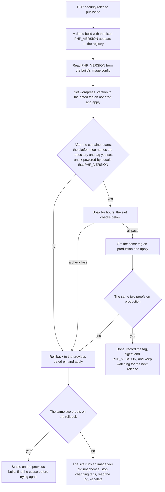

# Taking a PHP security release with a dated image tag

The module runs Microsoft's `mcr.microsoft.com/appsvc/wordpress-debian-php` image, and the tag is a PHP version
(`wordpress_version` on `modules/wordpress-site`, passed to `modules/app-service` as `docker_image_tag`; the default is the
floating `8.3`). What a floating tag (`8.2`, `8.3`) runs is decided by the platform on its own schedule, so when the PHP
project ships a security release, a floating tag gives you neither a version you choose nor one you can read in advance.
This page is for that case: it shows how to read a build's PHP version from the registry without Azure, how to pin a
dated build on a non-production site and prove that the platform runs it, how long to soak, how to promote the same
build, and how to roll back. The general tag policy and the full verification runbook are in
[Image-tag policy](../operations/image-tag-policy.md); this page does not repeat them.

Every registry and platform-log fact below is either quoted from a source or marked with the date it was measured.
Measurements are anonymous reads of the public registry, or what one consumer of this module observed on its own sites
and recorded on the dates given. Re-measure before you act on a number.

## What happened on 2026-10-21, and why a floating tag was not enough

| Fact | Source |
| --- | --- |
| On 2026-10-21 the PHP project released PHP 8.4.27, 8.3.36 and 8.2.35 (and 8.5.12). Each release entry says it is "a security release fixing two critical vulnerabilities (CVE-2026-109618, CVE-2026-109619) that can allow unauthenticated remote code execution" and that "there are no complete mitigations, updating is the only safe choice". The release was pre-announced on 2026-10-20 for 14:00 UTC. | php.net news archive: the entries [PHP 8.4.27 Released!](https://www.php.net/archive/2026.php#2026-10-21-4), [PHP 8.3.36 Released!](https://www.php.net/archive/2026.php#2026-10-21-3) and [PHP 8.2.35 Released!](https://www.php.net/archive/2026.php#2026-10-21-2), the [security advisory](https://www.php.net/archive/2026.php#2026-10-21-5) and the [pre-announcement](https://www.php.net/archive/2026.php#2026-10-21-1). The ChangeLog dates 8.4.27 as 22 Oct 2026, the news entry as 21 Oct. |
| CISA urged immediate patching on 2026-10-21, and its update of 2026-10-26 records the addition of both CVEs to the Known Exploited Vulnerabilities catalogue on 2026-10-26. | [CISA alert of 2026-10-21, revised 2026-10-26](https://www.cisa.gov/news-events/alerts/2026/10/21/critical-vulnerabilities-php-require-immediate-patching) |
| The App Service team wrote on 2026-10-21 that the updated built-in PHP images had reached both the Latest and the Standard Platform Release Channel, and, in a separate note, that WordPress apps deployed from the marketplace offering "have been updated to patched PHP versions, except for apps still using the older Alpine-based images". The note names no mechanism and no image tag. Custom containers are not patched by the platform. | [Critical PHP Security Release: What It Means for Azure App Service](https://azure.github.io/AppService/2026/10/21/php-critical-security-release-app-service-linux.html), updates of 21 October 2026 |
| The public registry's dated builds carried the fixed versions within an hour of the 14:00 UTC release: the `_20261021.5` build of each series was created between 14:54Z and 14:55Z with `PHP_VERSION` 8.4.27, 8.3.36 and 8.2.35 (`8.4_20261021.5.tuxprod`, `8.3_20261021.5.tuxprod`, `8.2_20261021.5.tuxprod`). A second 8.4 build followed at 15:20Z (`8.4_20261021.6.tuxprod`), and the `_20261022.4` builds of the next day carry the same versions. The last build before the release, `8.3_20261016.7.tuxprod`, has 8.3.35. | Measured 2026-10-30 with the [procedure below](#read-a-tags-php-version-without-azure) |
| The public registry's floating tags did not move: on 2026-10-30, nine days after the release, `8.3` still resolved to an image created 2025-10-16 with `PHP_VERSION=8.3.26`, and `8.2` to an image created 2025-01-21 with `PHP_VERSION=8.2.27`. A consumer measured the same two values on 2026-10-24. | Measured 2026-10-30 (and 2026-10-24 by a consumer) |
| What a floating tag runs on App Service is not the registry's floating image either. On 2026-09-27 a consumer's site configured with floating `8.3` was started from `appsvc/wordpress-debian-php:8.3_20260113.8.tuxprod` (the platform log's pull and start lines; PHP 8.3.29 from `x-powered-by` and the console log), newer than the registry's `8.3` of that day. | Measured 2026-09-27 by a consumer, from `AppServicePlatformLogs` |

So a floating tag gives you neither the registry's image nor a version you can read in advance: the platform decides,
on a schedule nothing published states for this image, and the only place that tells you what runs is the platform log
after a container start. To take a security release deliberately you pin a dated build, and from then on image patching
is your job (the input's own description says so).

## Read a tag's PHP version without Azure

The registry speaks the OCI distribution API: a manifest at `/v2/<name>/manifests/<reference>`, which the client asks
for with an `Accept` header naming the manifest types it understands, and blobs at `/v2/<name>/blobs/<digest>`
([OCI distribution spec, "Pull"](https://specs.opencontainers.org/distribution-spec/?v=v1.0.0#pull)). The image's
configuration is a blob; its `config.Env` list holds the environment the image was built with, and this image puts the
PHP version there as `PHP_VERSION=<x.y.z>` (measured 2026-10-30 on every tag checked). The reads below are anonymous: no
login, no Azure. Run them in a shell with `set -euo pipefail`; every `curl` carries `-f`, so a missing tag or a bad
digest stops the sequence instead of writing an error page into the file the next step reads.

1. **List the tags.** Dated builds are named `<php>_<YYYYMMDD>.<n>.tuxprod`:

   ```bash
   REPO=appsvc/wordpress-debian-php
   curl -sSf "https://mcr.microsoft.com/v2/$REPO/tags/list" | jq -r '.tags[]' | sort
   ```

   Measured 2026-10-30: 101 tags, of which two were floating (`8.2`, `8.3`) and the rest dated 8.2, 8.3 and 8.4 builds.
   `8.4` as a floating tag does not exist (`manifests/8.4` answers `404 MANIFEST_UNKNOWN`).

2. **Fetch the manifest** of the tag you are considering, asking for both the single-image and the index (manifest list)
   types, and keep the response headers:

   ```bash
   TAG=8.4_20261022.4.tuxprod   # example: pick one from the list
   ACCEPT='application/vnd.oci.image.index.v1+json, application/vnd.docker.distribution.manifest.list.v2+json, application/vnd.oci.image.manifest.v1+json, application/vnd.docker.distribution.manifest.v2+json'
   curl -sSf -H "Accept: $ACCEPT" -D manifest.headers -o manifest.json "https://mcr.microsoft.com/v2/$REPO/manifests/$TAG"
   grep -i '^docker-content-digest' manifest.headers
   jq -r '.mediaType' manifest.json
   ```

   The `Docker-Content-Digest` header is the digest of the manifest you received, and it depends on the `Accept` header:
   without one the registry answers `404` for `8.3` and a converted schema 1 manifest with a different digest for the
   dated tags (measured 2026-10-30). Always read the digest with the same `Accept` header.

3. **If the manifest is an index** (`mediaType` ends in `image.index.v1+json` or `manifest.list.v2+json`), it has a
   `manifests` list with one entry per platform. App Service on Linux runs `linux/amd64`, so pick that entry's digest
   and fetch the platform manifest it points at:

   ```bash
   DIGEST=$(jq -r '.manifests[] | select(.platform.os == "linux" and .platform.architecture == "amd64") | .digest' manifest.json)
   curl -sSf -H "Accept: $ACCEPT" -D manifest.headers -o manifest.json "https://mcr.microsoft.com/v2/$REPO/manifests/$DIGEST"
   ```

   Measured 2026-10-30: every tag checked (`8.2`, `8.3` and fourteen dated builds) answered a single-platform manifest,
   so this step was not needed that day. `8.3` answers an OCI image manifest and the dated builds a Docker schema 2
   manifest; the `Accept` header above covers both.

4. **Fetch the configuration blob, check it, and read the version.** The blob endpoint answers with a `307` redirect to
   a storage host, so `curl` needs `-L`; the blob's SHA-256 must equal its digest, and `sha256sum -c` fails the sequence
   if it does not:

   ```bash
   CONFIG=$(jq -r '.config.digest' manifest.json)
   curl -sSfL -o config.json "https://mcr.microsoft.com/v2/$REPO/blobs/$CONFIG"
   echo "${CONFIG#sha256:}  config.json" | sha256sum -c -
   jq -r '.created, (.config.Env[] | select(startswith("PHP_VERSION=")))' config.json
   ```

   For `8.4_20261022.4.tuxprod` this printed `config.json: OK`, `2026-10-22T15:54:54.969397361Z` and
   `PHP_VERSION=8.4.27` on 2026-10-30. Compare the version with the fixed version in the PHP announcement, not with the
   tag: the tag names a series and a date the publisher assigns, never the patch level, and that date is not the image's
   `created` time either. Measured 2026-10-30: the `_20261020.9` tag of each series points at the same configuration as
   its `_20261021.5` build, created on 2026-10-21 with the fixed version, so a watcher who waits for a tag dated 10-21
   would have missed it.

Keep the tag, the manifest digest from step 2 (or from `curl -sSfI -H "Accept: $ACCEPT"` on the manifest URL) and the
`PHP_VERSION` you read in the change record. They are what the proof below is checked against.

## Pin the build on a non-production site and prove it



1. **Set the tag** in the non-production configuration and read the plan. It must show `docker_image_name` updated in
   place on the app, and on the staging slot when there is one (an S\* or P\* SKU with `app_service.staging_slot_enabled`
   left `true`), and nothing else:

   ```hcl
   wordpress_version = "8.4_20261022.4.tuxprod" # the build whose PHP_VERSION you read above
   ```

   On a standalone `modules/app-service` call the input is `docker_image_tag`. Move within a series when the release
   is a security fix: pin the fixed build of the series you already run. A change of series (for example `8.3` to a
   dated `8.4` build) is a PHP upgrade for WordPress and every plugin, and deserves its own soak.

2. **Apply.** The app restarts and pulls the image. Give the platform log some minutes to arrive.

3. **Prove the image from the platform log.** Only a `Creating container with image:` line is a start; a `Pulling image:`
   line alone proves nothing, because a pull can succeed without a container being created from it. In the Log Analytics
   workspace:

   ```kusto
   AppServicePlatformLogs
   | where TimeGenerated > ago(2h)
   | where _ResourceId contains "<app-name>"
   | where Message has "Creating container with image"
   | project TimeGenerated, _ResourceId, Message
   | order by TimeGenerated desc
   ```

   The newest line after your apply must name `appsvc/wordpress-debian-php` with the exact tag you set. Any other
   repository, or any other tag, means the platform did not run what you asked for: roll back (below). `_ResourceId` is
   in the output because a staging slot's rows match the same filter and end in `/slots/staging`: prove the app and the
   slot each on their own newest line. The slot's rows reach the workspace only when `staging_slot_diagnostic_settings`
   is set (the default creates no diagnostic setting on the slot; `{ default = {} }` sends the app's four categories to
   the site workspace); without it, prove the slot from `linuxFxVersion` with `--slot staging` (runbook step 4) and from
   `php -v` over SSH to the slot (step 5 below). The table and its columns are from Microsoft's
   [table reference](https://learn.microsoft.com/azure/azure-monitor/reference/tables/appserviceplatformlogs); the
   runbook has the legacy `AzureDiagnostics` form of the query. Two measured line shapes, both from one consumer:

   - 2026-10-24, dated pin: `Pulling image: mcr.microsoft.com/appsvc/wordpress-debian-php:8.4_20261022.4.tuxprod`, then
     `Creating container with image: … 8.4_20261022.4.tuxprod from registry: mcr.microsoft.com`.
   - 2026-09-27, floating `8.3`: `Pulling image: appsvc/wordpress-debian-php:8.3_20260113.8.tuxprod`, with no registry
     named, followed by the start line for that image at 20:56:34Z.

4. **Prove the PHP that serves the site.** PHP adds `X-Powered-By: PHP/<version>` to responses while the `expose_php`
   directive is on ([php.net, core ini directives](https://www.php.net/manual/en/ini.core.php#ini.expose-php)); this
   image sent it on each of a consumer's checks between 2026-08 and 2026-10. Read it from a response that was not served
   from a CDN cache, and read the cache-status header to know. Behind Cloudflare the module bypasses the cache on
   `wp-admin/*` and `wp-login.php` and caches `wp-content/*` (`modules/cloudflare/page-rules.tf`); the front page is
   cached only where you added an HTML cache rule, so treat `cf-cache-status: HIT` as a cached answer. Behind Azure
   Front Door the module's route caches every path except `wp-admin/` and `wp-login.php` (`modules/front-door/main.tf`,
   the route's `cache` block and the `NoCacheAdmin` rule) and reports a cached answer as `x-cache: TCP_HIT` or
   `TCP_REMOTE_HIT` ([Front Door caching](https://learn.microsoft.com/azure/frontdoor/front-door-caching)). A unique
   query string avoids a cached answer on that route, whose cache key includes the query string:

   ```bash
   curl -sSI "https://<custom-domain>/?check=$(date +%s)" | grep -i -e '^x-powered-by' -e '^cf-cache-status' -e '^x-cache'
   ```

   The value must equal the `PHP_VERSION` you read from the build's config, to the patch level. A missing header with
   an otherwise healthy site means `expose_php` is off and this check cannot be made: fall back to `php -v` over SSH
   (runbook step 6, which asks only for the series; for a security release compare the patch level), which is also the
   check Microsoft's own post on the release suggests. A consumer measured the header move from `PHP/8.4.21` to
   `PHP/8.4.27` within about four minutes of the apply on 2026-10-24, on nonprod and again on production.

5. **Check the rest of the start:** the front page and the health-check path answer `200`, SSH or Kudu works, and the
   staging slot, if there is one, is proved the same way on its own log rows. The slot's hostname is behind the same
   origin restriction as the app (when `cdn_provider` is not `direct`, only the CDN's addresses reach it:
   `modules/app-service/main.tf`, the slot's `ip_restriction` blocks), so for its PHP version use `php -v` over SSH to
   the slot, `az webapp ssh --resource-group <app-resource-group> --name <app-name> --slot staging`, which works
   while SCM access is open (`scm_ip_restriction_default_action`, default `Allow`).

### Why you prove it after the start, every time

A clean plan and a green apply prove what Azure was asked for. What runs is decided by the platform when the container
starts, and the platform documents neither where it pulls a tag of this image from nor when it substitutes. Two
measurements by one consumer, a month apart, show both outcomes:

- **2026-09-27.** A site configured with the dated tag `8.3_20260922.3.tuxprod`, which existed on the public registry, was
  started from `appsvc/wordpress-alpine-php:8.0_20241014.2.tuxprod` pulled from a registry address inside the platform.
  No `Pulling image` line named the configured tag and no error was logged. The site served `x-powered-by: PHP/8.0.30`
  while the Kudu sidecar crash-looped, so SSH stopped working. The cause was never established; the pin was reverted.
- **2026-10-24.** A site configured with `8.4_20261022.4.tuxprod` was started from exactly that image, pulled from
  `mcr.microsoft.com` by the platform log's own account, on nonprod and then on production.

The two do not contradict each other: they are what the platform did with two different builds on two dates, and
nothing published says which behaviour a given build will get. Microsoft documents the Platform Release Channel for the
built-in Linux runtimes ([OS and runtime patching](https://learn.microsoft.com/azure/app-service/overview-patch-os-runtime#control-runtime-patch-update-timing-with-platform-release-channel));
nothing it publishes says whether, or how, the floating tags of this image follow it, and nothing covers a dated tag. The
only evidence on this page that the platform updates a floating tag at all is the 2026-09-27 measurement above, and no
floating-tag site was measured after 2026-10-21. So: prove every image change after the container starts, from the
platform log and from `x-powered-by`, and do it on a non-production site before production. The first measurement is
also why a rollback gets the same proof as a rollout.

## Soak, then promote the same build

For a security release the question is whether the fixed build of the series you already run behaves like the build it
replaces, so a soak of hours is reasonable, where a change of series would need days. A consumer soaked
`8.4_20261022.4.tuxprod` on nonprod for about four hours on 2026-10-24 before promoting it. Exit checks, all taken after
the container start that the platform log proved:

- the two proofs above still hold at the end of the soak (no newer `Creating container with image:` line for the app,
  or for the slot where its rows are collected, names a different image, and `x-powered-by` is unchanged);
- the front page, a logged-in `wp-admin` page and the health-check path answer `200`;
- every scheduled job that ran in the window (WP-Cron, backups, any probe you run) is green;
- `AppServiceHTTPLogs` since the start shows no rise in 5xx responses against the previous days;
- `AppServiceConsoleLogs` since the start shows no PHP fatal error. Judge new lines against the previous build's start:
  this image logs the same supervisor notices at every start, and a consumer recorded an identical pair at a 2026-10-11
  start of a different build that went on to pass a seven-day soak;
- SSH or Kudu still works, so an upgrade or a restore remains possible.

Then set the same tag on production, read its plan, apply, and repeat the two proofs there. Promote the build you
soaked, by tag and digest, not "the newest build": the registry publishes several builds a week (measured 2026-10-30:
builds dated 10-21, 10-22, 10-27 and 10-29 for each series), and each is a new image.

## Rollback

Set the previous **dated** tag you ran, the one your change record names, and apply. Then take the two proofs again:
the first measurement above is a rollback case too. Rules:

- **Never roll back across a PHP series** (for example from a dated `8.4` build to `8.3`): WordPress and its plugins
  have run on the newer series since the change, and a lower series is a downgrade of the runtime under live content.
  Roll back to the previous build of the same series.
- **A floating tag is not a rollback target.** It has no previous value, and on 2026-10-30 the registry's `8.3` and
  `8.2` images were a year or more old, with unfixed PHP. If the site ran a floating tag before the pin, roll back to
  the build the platform log says it was running then (the last `Creating container with image:` line before your
  change), as a dated tag.
- If the rollback's own proof fails, the site is running an image you did not choose. Stop changing tags, read the
  whole platform log since the first change, and escalate.

The tag selects the container image only; it backs nothing up. For a change of series take a
[backup](../operations/backup-and-restore.md) first.

## A dated pin makes the security watch your job

With a floating tag the platform decides when the site picks up a fixed image, on a schedule nothing published states;
the App Service team's post says marketplace WordPress apps were updated on the release day without saying by what
route. A dated pin takes even that away: the image changes only when you change the tag, so from the day you pin you
have to notice the next release yourself. What to watch, with how fast each moved on 2026-10-21:

- **The PHP project's announcements**: the [news archive](https://www.php.net/archive/2026.php) and the
  `php.announce` list. The 2026-10-21 release was pre-announced on 2026-10-20 for 14:00 UTC, which is time to prepare
  the non-production change.
- **The registry's tag list** (step 1 above), read with the configuration's `created` time and `PHP_VERSION`, not the
  date in the tag. On 2026-10-21 the `_20261021.5` builds of all three series were created between 14:54Z and 14:55Z,
  within an hour of the 14:00 UTC release, with the fixed versions; 8.4 got a further build at 15:20Z and every series
  another the next day (measured 2026-10-30).
- **The App Service team's blog** for the platform's own statements on a release.
- **The series' support dates** on [php.net](https://www.php.net/supported-versions.php): a pinned build of a series that
  has left security support gets no fixed build at all, so plan the series change before that date.

Record, for every site, the tag, its digest and its `PHP_VERSION`, and the date you last compared them with the current
release. A pinned site with no record is a site nobody is watching.

## Sources

`modules/wordpress-site/variables.tf` (`wordpress_version`, `staging_slot_diagnostic_settings`, `app_service`),
`modules/app-service/variables.tf` (`docker_image_tag`), `modules/app-service/main.tf` (`docker_image_name` on the app and
the slot, `create_staging_slot`), `modules/front-door/main.tf` (the route's `cache` block and the `NoCacheAdmin` rule); the
[Image-tag policy](../operations/image-tag-policy.md) runbook; the php.net [news archive](https://www.php.net/archive/2026.php)
(the three release entries, the security advisory and the pre-announcement of 2026-10-21, as linked above) and
[core ini directives](https://www.php.net/manual/en/ini.core.php#ini.expose-php); the
[CISA alert](https://www.cisa.gov/news-events/alerts/2026/10/21/critical-vulnerabilities-php-require-immediate-patching);
the App Service team's [post on the release](https://azure.github.io/AppService/2026/10/21/php-critical-security-release-app-service-linux.html)
and Microsoft's [OS and runtime patching](https://learn.microsoft.com/azure/app-service/overview-patch-os-runtime),
[AppServicePlatformLogs](https://learn.microsoft.com/azure/azure-monitor/reference/tables/appserviceplatformlogs) and
[Front Door caching](https://learn.microsoft.com/azure/frontdoor/front-door-caching) pages;
the [OCI distribution specification](https://specs.opencontainers.org/distribution-spec/?v=v1.0.0); anonymous reads of
`mcr.microsoft.com` on 2026-10-30; and one consumer's measurements of 2026-09-27, 2026-10-11 and 2026-10-24, as dated in
the text.
